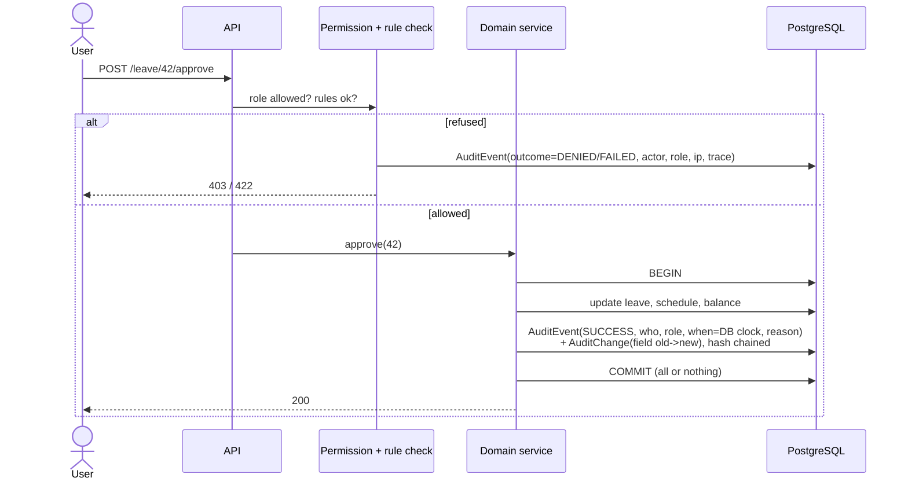
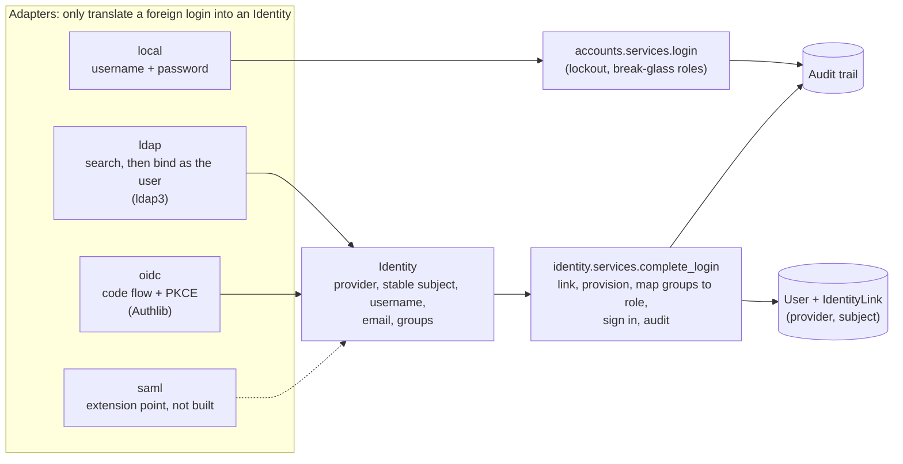

# Gijima WFM — Technical Specification

Status: **Draft v0.2.** Back end decided (Django) and front end decided (Vue 3), 12 Oct 2026. Hosting target undecided: built to be portable (§9). Requirement IDs refer to `01-REQUIREMENTS.md`.

## 1. Architecture and stack

Constraint: **open-source only, no paid licences** (production or development).

| Layer | Choice | Licence | Why |
|---|---|---|---|
| Frontend | Vue 3 (Composition API, `<script setup>`), TypeScript, Vite, Vue Router, Pinia (client state only), TanStack Query for Vue (server state), Tailwind CSS, Apache ECharts via vue-echarts | MIT / Apache-2.0 | Decided by VMK. The reference app was React, so its screens are re-implemented, not reused; the UI spec is framework-neutral |
| Backend API | Python 3.12, Django 5.2 LTS, Django Ninja (typed endpoints + OpenAPI) | BSD-3 / MIT | CRUD-, RBAC- and audit-heavy domain; built-in ORM, migrations, auth, admin |
| Audit trail | Own `AuditEvent` + `AuditChange` tables written by the service layer (authoritative); django-simple-history only for per-row version snapshots/History tabs | BSD-3 | Accountability (§6.1). simple-history alone is not enough: it does not fire on bulk operations |
| Engine | Plain Python package `wfm_engine` (NumPy, pandas, openpyxl, Google OR-Tools CP-SAT) — no Django imports | BSD / BSD / MIT / Apache-2.0 | Framework-free; unit-tested in isolation |
| Database | PostgreSQL 16 | PostgreSQL Licence (BSD-like) | Interval tables, window functions for reporting |
| Jobs | Celery + **Valkey** as broker | BSD-3 / BSD-3 | Imports, forecast runs, auto-schedule, report packs. Valkey rather than Redis because Redis ≥ 7.4 is no longer BSD-licensed (RSAL/SSPL, AGPL from 8.0) |
| Auth | Django sessions (HttpOnly cookie + CSRF) for the SPA; local users for dev/demo; Azure AD via OIDC (mozilla-django-oidc, MPL-2.0) in production | — | NFR-04 |
| Tests | pytest, pytest-django, testcontainers-python, Vitest, Playwright | MIT / BSD / Apache-2.0 / MIT / Apache-2.0 | §7 |
| Container runtime (dev) | Docker Engine on Linux/CI; **Docker Desktop** (WSL2 backend) on Windows dev machines | Apache-2.0 (engine) / Docker Desktop: free below 250 staff and US$10m revenue | VMK is under both limits (confirmed 12 Oct 2026). If VMK grows past either limit, switch to Rancher Desktop or Podman: nothing in the project depends on Docker Desktop specifically |
| Hosting | Docker Compose for dev; Azure South Africa North for production | — | NFR-03 data residency (hosting itself is a cost, not a licence) |

```
web (SPA) ──HTTPS/JSON──> api (Django + Ninja) ──> PostgreSQL
                               │   └── wfm_engine (pure Python)
                               └─> worker (Celery: imports, forecast, optimiser, reports) ─> Valkey
```

Repository layout:
```
/web        SPA (Vue 3)
/api        Django project  (config/, apps: accounts, org, people, forecasting, scheduling, leave, overtime, reporting, imports)
/engine     wfm_engine package (Erlang C, forecast, optimiser, KPI calc) — pure Python
/docs       these specs
/Files      source material (not deployed)
docker-compose.yml
```

## 2. Domain model (core tables)

| Entity | Key fields |
|---|---|
| Site | id, name, timezone |
| Customer / Contract | id, name, tier, sl_target_pct, sl_threshold_s, abandon_target_pct, asa_target_s, aht_target_s |
| Queue | id, site_id, contract_id, name, channel (voice/email/ticket), direction (inbound/outbound), open_hours, occupancy_ceiling |
| Employee | id, emp_no, name, team_id, manager_id, contract_type (permanent/seasonal), weekly_hours, work_mode (office/remote/hybrid), start/end date, **field_source** (imported / default) |
| AgentLogin | login (e.g. Agent124), employee_id — many-to-one (DAT-05) |
| Skill | employee_id, queue_id, level (L1–L3), proficiency |
| ShiftTemplate | code, start, end, paid_minutes, kind (early/day/late/night/split) |
| RosterWeek | queue/site, week_start, status (draft/published), published_by/at |
| ShiftAssignment | employee_id, date, template_id or start/end, queue_id, roster_week_id |
| Activity | shift_assignment_id, type (break/lunch/training/meeting/coaching), start, end, on_phone=false |
| Availability | employee_id, kind (unavailable/preferred), weekday or date, window, reason |
| LeaveType / LeaveBalance / LeaveRequest | type, entitlement days; request: employee, dates, part-day, status, approver |
| SwapRequest | from_assignment, to_assignment, status |
| OvertimeRequest / Standby / Callout | employee, date, minutes, rate multiplier, cost, status |
| CallRecord | call_id (unique), queue_id, login, type, start, queue_time, agent_time, hangup, wait_s, talk_s, wrap_s, hold_s, status, hangup_by |
| IntervalActual | queue_id, interval_start, offered, answered, abandoned, answered_in_sl, sum_wait_s, sum_handle_s |
| ForecastVersion / ForecastInterval | version: queue, label, status (draft/published), method; interval: volume, aht_s |
| ForecastEvent | queue, date range, uplift %, reason |
| RequirementInterval | queue, interval_start, forecast_version_id, required_raw, required_with_shrinkage (cached) |
| ShrinkageAssumption | team/queue, planned_pct, unplanned_pct, effective_from |
| CapacityPlan / CapacityPeriod / HiringCohort | horizon, attrition %, ramp curve, cost per FTE |
| ImportBatch | file name, sha256, sheet counts, period, row counts, reconciliation JSON, status |
| User / Role | role ∈ planner/lead/agent/admin/executive (+ optional auditor) |
| AuditEvent | id, occurred_at (DB `clock_timestamp()`), actor_user_id, actor_role, actor_type (USER/SYSTEM/INTEGRATION), subject_employee_id (nullable), action (enum), entity_type, entity_id, outcome (SUCCESS/DENIED/FAILED), reason, request_id, trace_id, session_hash, ip, user_agent, batch_id (nullable), prev_hash, hash |
| AuditChange | audit_event_id, entity_type, entity_id, field, old_value, new_value (sensitive values stored but only visible to roles allowed to see the field) |

All interval timestamps stored in UTC, displayed in Africa/Johannesburg; interval length 30 min (configurable).

## 3. API (REST, `/api/v1`)

`auth/login`, `auth/me` · `sites`, `queues`, `contracts`, `shift-templates`, `skills`, `activities` (CRUD, admin) · `employees`, `employees/{id}/logins` · `imports` (POST file → batch; GET report) · `intervals/actuals?queue&from&to` · `forecasts` (list, run, publish), `forecasts/{id}/intervals`, `forecast-events` · `planner/week?queue&week` → {intervals[ {start, required, scheduled, variance} ], kpis} · `planner/day?queue&date` · `planner/auto-schedule` (job) · `recommendations?queue&date`, `recommendations/{id}/apply` · `roster?queue&week`, `roster/assign`, `roster/clear`, `roster/publish`, `roster/export.csv` · `availability` · `leave`, `leave/{id}/approve|reject|cancel`, `leave/balances` · `swaps` · `overtime`, `standby`, `callouts` · `capacity/plans` · `intraday?queue&date` · `analytics/kpis`, `analytics/trend`, `analytics/scenario` · `reports/peaks-troughs`, `reports/packs`, `reports/payroll.csv` · `dashboard?site&week` · `audit` · `notifications`.

Every response carrying a KPI includes `{value, basis: "measured"|"modelled", coverage: {intervals_used, intervals_total}}` (DAT-10).

## 4. Engine

### 4.1 KPI definitions (pinned by reconciling the real May and July reports to DECK slide 2)
Computed per queue over **inbound** calls only (`Call Type = INBOUND`; outbound calls and transfer legs are other work):
- Offered = count of inbound calls; Answered = `Call Status = Agent`; Abandoned = `Call Status = Abandoned`
- Abandon % = abandoned / offered
- SL@20s = answered with `Queue Wait Time ≤ 20 s` **÷ offered** (not ÷ answered: that gives 88.4% for May, the deck says 81.1%)
- ASA = mean queue wait of answered calls
- AHT = mean of (`Agent Duration` + `Disposition Duration`) of answered calls, i.e. talk plus wrap-up (talk alone gives 3:05 for May, the deck says 3:35)

Acceptance (all matched exactly, verified against the real files by `api/wfm/telephony/tests/test_real_reports.py`):

| | Offered | Answered | Abandoned | Abandon % | SL@20s | ASA | AHT |
|---|---|---|---|---|---|---|---|
| May | 5,649 | 5,181 | 468 | 8.28% | 81.1% | 18.5 s | 3:35 |
| July | 4,837 | 4,632 | 205 | 4.24% | 89.8% | 11.7 s | 3:22 |

The earlier puzzle (480 abandoned in the raw status column against 468 on the deck) is explained: the 480 counts abandoned rows of every call type; 468 of them are inbound.

A ratio with nothing to divide by is **no figure**, never zero (DAT-10): an empty month must not read as perfect service.

### 4.2 Requirement (Erlang C) per interval
```
λ = forecast volume / interval_seconds;  A = λ · AHT          (traffic, Erlangs)
EC(N,A) = (A^N/N! · N/(N−A)) / (Σ_{k=0}^{N−1} A^k/k! + A^N/N! · N/(N−A))
SL(N) = 1 − EC(N,A) · exp(−(N−A) · T / AHT)                    (T = SL threshold, e.g. 20s)
N_raw = min N > A such that SL(N) ≥ target AND A/N ≤ occupancy ceiling
N_req = ceil(N_raw / (1 − shrinkage))
```
Computed iteratively in log space to avoid factorial overflow. Variance = scheduled_on_phone − N_req.

### 4.3 Forecast (baseline built in Phase 1)
**How it works.** For a target day, take the most recent *k* (default 4) earlier days with the same weekday **that have call data**, and take a weighted average per half-hour slot, newer days counting more (weights 1, 0.7, 0.49, ...). Handling time is the answered-volume-weighted average of the same days, falling back to the overall figure for a slot where nothing was answered. Versions are drafts until published; exactly one version per queue is live and publishing archives the previous one (FC-03). The staffing requirement per half-hour is Erlang C on the forecast (section 4.2), with the queue's assumptions recorded on the version.

**Honesty rules (DAT-10), each tested.**
- A day with no imported data is not a day with no calls: only observed days count; on an observed day a slot with no row really had zero calls.
- Never peeks: only days before the target are used, in the forecast and in the accuracy backtest.
- No history means no forecast, never a forecast of zero; days that could not be forecast are named, not filled.
- The staffing assumptions (80% in 20 s, 85% occupancy ceiling, 30% shrinkage) are **unconfirmed defaults** until an admin confirms them, and the screen says so. A requirement that cannot be worked out is "-", never 0, and a maximum is not claimed when part of it is unknown.
- A forecast built on call data 28 or more days older than its first day carries a warning.

**Accuracy (FC-05), measured not modelled.** Each past day is forecast from only the days before it and scored two ways: per half-hour and on the day's total. The score is 100% minus the pooled absolute error over the pooled actual calls (not MAPE, which divides by the zero actuals of quiet half-hours).

**What the real May and July reports show** (aggregates; baseline with no trend or seasonality):

| Queue | Day total | Half-hour |
|---|---|---|
| TotalSA | 71.8% | 41.8% |
| Platinumhealth | 68.8% | 12.3% |
| Gijima | 59.6% | 0% |
| NightShiftGijima | 48.3% | 0% |
| NightShiftTotalSA | 48.2% | 0% |
| PPECB | 42.9% | 0% |

The half-hour score is low for small queues because a half-hour holds a call or two and chance alone moves it; the day score is the one staffing a day leans on, and even that is only moderate. **This is a first baseline, not a finished forecast.** Likely gains, in order: a trend factor and day-level (rather than slot-level) averaging, smoothing neighbouring half-hours for small queues, holiday and event uplifts (FC-04), then the Phase 7 machine-learning model (FC-07) judged against this backtest.

**Not built yet:** the monthly trend factor, multi-channel (FC-06), ML (FC-07), per-queue and per-contract settings screens (ENG-05; the values exist on the queue but are changed in Configure, Phase 2). Whole days are assumed: an import that stops mid-day would make that day look quiet.

### 4.3c Events calendar (Phase 2.5, built)
A planner or admin enters a planned reason for demand to differ: a name, the first and last day, one queue or all queues, and a change in calls from -100% (closed) to +500%. Forecasts run **after** that apply it to every covered day, for the baseline and for Prophet alike; the staffing requirement is then worked out from the adjusted volume.

- Overlapping events **compound** (a +20% campaign during a -50% outage is x1.2 x0.5 = x0.6), and the Prophet range scales with the day.
- The event is a manual adjustment on top of the model, so Prophet is **not** given events to learn from (that would count a past campaign twice). Learning event effects from history is a later step, once there is enough history for it to be meaningful.
- A forecast already run keeps what it used: the events that touched it are stored on the version (`params.events`, with the days) and shown on the screen, so removing an event later never rewrites a published forecast.
- Roles: admin and planner change the calendar, leads read it, nobody else sees it. Create, change and remove are audited with the before and after values; saving without changes records nothing.
- Edit has an API (`PUT`) but no screen yet; add and remove cover the planner's need.

### 4.3d Capacity against the workforce (Phase 2.5, built)
Capacity answers one question per day: how many people must be working **at the same moment** at the busiest half-hour, and can the permanent staff, then the seasonal pool, cover it (requirement CAP-01; tender: up to 350 agents, 100 permanent and 250 seasonal).

- **Source.** The published forecast of every queue (agents to roster, shrinkage included), added up half-hour by half-hour across queues (`wfm_engine.capacity.combine`); the day's figure is the busiest half-hour (`peak`), not the sum of the day.
- **Split.** Permanent staff fill first, then seasonal agents up to their pool, and what is left is **overflow** (needs overtime, another site or an outsourcer). Parts always add up to the peak (`split_demand`).
- **Honesty.** A day with no published forecast has no figures (dashes, never zeros). A day where only some queues are forecast, or a half-hour could not be staffed, is a **minimum** and says "at least this many: 1 of 2 queues". Drafts and archived forecasts never count.
- **On the books.** Permanent staff and seasonal agents employed that day (from the employee dates) and the seasonal agents **still to find** (needed minus engaged, never negative). Only counts leave the API, never names.
- **Limits.** One row for the deployment, the tender's 100 and 250 until an admin confirms or changes them in Configure, Workforce (audited, with before and after). The screen warns while they are unconfirmed.
- **Roles.** Admin, planner, executive and customer operations read it; only the admin sets the limits. Leads and agents are refused.
- **Not modelled yet.** A person works a shift, so headcount to cover shifts, leave and rest is higher than the simultaneous peak; this view is the floor for hiring, not the roster. Attrition and hiring pipelines are not tracked.

### 4.3e What-if scenarios (Phase 2.5, built)
A planner, lead or admin picks a forecast version and changes any of: calls (-100% to +500%), handling time (-90% to +500%), shrinkage, or the service-level target. The staffing is worked out again with the same function the forecast used (`forecasting/staffing.py`), and the screen shows base against scenario per day: calls, the most agents to roster at once, and agent-hours (agents to roster x half an hour), with the change signed.

- **Read-only.** Nothing is saved, no version is created and no audit event is written; the forecast is never touched. A scenario of "no change" reproduces the base, which is tested.
- **The base is the forecast's own**: the assumptions it was run with (stored on the version), not the queue's current ones, so changing a queue's shrinkage later does not rewrite what an old forecast meant.
- **Honest about gaps.** A half-hour with calls but no known handling time cannot be staffed; the day is marked a minimum (asterisk) rather than counting it as zero.
- Not in this version: saving and naming scenarios, comparing several side by side, headcount what-ifs (leave, hiring) and linking a scenario to the capacity pools; those wait for Phase 4 (optimise).

### 4.3f Planning overview on the dashboard (built)
The dashboard opens with the planner's week at a glance, above the measured service figures (reference UI: the dashboard in the video). `GET /scheduling/overview?week_start=` builds it from `week_plan` for every queue, so the dashboard and the planner screen can never disagree.

- **Cards:** coverage gap (people-half-hours short, over-staffing offsets nothing), under-staffed intervals as a share of those with a known requirement, queues with a forecast, rosters published, headcount employed in the week. Occupancy and pending approvals are not shown: occupancy needs agent-state data and approvals need Phase 3; nothing is invented to fill the space.
- **Coverage by queue**, worst-staffed first, queues with no requirement last; choosing a queue opens its planner on it. **Gap by day** across queues.
- **Needs attention** is a list of plain rules, not AI (`wfm_engine/attention.py`): under-staffed intervals (critical from a quarter of the known half-hours, else a warning), no published forecast for the week, unconfirmed staffing assumptions, a roster still in draft. Most serious first, biggest first within a severity; each item links to where it is fixed. A published forecast that does not reach the week counts as no forecast for it.
- **Roles:** admin, planner and lead (same as the planner); executives and customer operations see only the measured figures and the API refuses them.
- **Not built yet:** the video's week-trend service-level line (needs measured service level per day), a recent-activity feed (it would show who did what; the audit trail is admin-only, so a role-level, name-free feed needs its own design), and the Copilot link (parked).

### 4.3g Calibration: tuning and back-test (built)
A queue's forecast is tuned with four settings (requirement RPT-07; reference UI: the Calibration screen in the video): how many weeks to look back (1-12), a recency weight (0.1-1: how much less each older same-weekday day counts), a contacts multiplier and a handling-time multiplier (0.5-2, corrections for a forecast that runs high or low). A queue with no saved tuning uses the defaults the baseline always had (4 weeks, 0.7, 1, 1) and the screen says nobody has saved one.

- **Back-test before saving.** `GET /forecasting/tuning/backtest` scores any candidate tuning against what really happened (each past day forecast from only the days before it) next to the saved tuning, on the same days: day totals right, half-hours right, and **bias**. Nothing is saved by asking.
- **Bias keeps its sign.** Forecast total against actual, so "ran 48% low" is different from "ran 48% high" and is fixed differently; accuracy alone cannot tell them apart. The suggested contacts multiplier is the one that would remove the candidate's bias (multiplier / (1 + bias)), clamped to 0.5-2; none when there is no data.
- **Saved tuning is used everywhere the baseline is:** forecasts run afterwards (recorded on the version as `params.tuning`, so an old forecast keeps what it was made with), the accuracy figures, and the baseline Prophet must beat (a tuned baseline is a harder opponent, which is the point). Prophet's own forecast uses the lookback and recency weight for its daily shape and the multipliers as a correction.
- **Roles:** admin and planner open the screen and save; leads can read the tuning through the API but the screen is not theirs; every save is audited with before and after, and saving the same again records nothing.
- **Not in this version** (the video's screen has more): outlier cleansing, a growth-per-year trend, shrinkage by category, full-time/part-time days, per-site and per-contract layers that inherit from a parent. Each is a setting the forecast would have to honour, so each waits for the feature that uses it.

### 4.3h Service desk workload (built)
Ticket work is not staffed like calls (requirement SD-01; reference UI: the Service desk screen in the video, "This is not Erlang"). A caller who is not answered abandons; a ticket that is not picked up is still there tomorrow. So per **resource pool** (Service Desk, NOC, SOC, Field Services...) the people needed over a period are:

```
required = ( effort due by the end of the period  +  expected arriving effort )
           / ( productive minutes per day x working days in the period )
```
Effort is engineer time, never the SLA window (a four-hour P1 can hold twenty minutes of work). Pure rules in `wfm_engine/workload.py`, tested by hand: a pool with 720 minutes due and 180 minutes a day arriving over 5 working days at 360 productive minutes needs (720 + 900) / 1800 = 0.9 people.

- **Work items** are brought in from an ITSM export (CSV: `ref`, `pool`, `opened`, and optionally `priority`, `due`, `effort_minutes`, `closed`). They hold a reference, a pool, dates and an effort estimate, **never a person**: any other column (requester, assignee, text) is ignored and not stored, so it cannot reach the database by being in the file. Known references are updated, so the same export can be brought in again as tickets are closed; nothing is deleted. Rows that cannot be read are counted by reason, never kept or echoed. The audit trail holds counts only.
- **Honesty (DAT-10).** An item with no effort estimate cannot be sized and an item with no deadline is in the backlog but not in the requirement; both are counted per pool and make the figure a minimum ("at least 0.60"). Arrivals are measured from the items opened in the 28 days before the period; a pool with nothing opened has **unknown** arrivals, not zero (a quiet month and a missing export look the same). Breached means past its deadline when the period starts; breached work still has to be done.
- **Productive time** per pool (default 360 of an 8-hour day, an assumption until a planner or admin confirms it) is editable and audited. Public holidays are not taken off the working days: adjust the productive time.
- **Roles:** admin, planner and customer operations read it; admin and planner bring work in and set the productive time. Feature `service_desk`.
- **Not built yet:** the video's Backlog, SLA & quality, Utilisation & cost and Work items tabs (utilisation and billability are SD-02), skills-based allocation to L1/L2/L3 (SD-03), a direct ITSM connection (Phase 6; today it is a file), and Customer Operations Managers, which the video sizes through the interval engine because they are a real-time queue, not deadline work.

### 4.3i Leave and approvals (Phase 3, built)
Requirements LV-01 to LV-03 and the agent's own view (ESS-01). Pure rules in `wfm_engine/leave.py`; the app is `wfm.people`.

- **Kinds and balances.** Annual, sick, family responsibility, study, maternity, training and unpaid, with South African (BCEA) entitlements as defaults: annual 15 working days (21 consecutive days), sick 10 a year (30 over three years), family 3, maternity about 85. They are **defaults nobody has confirmed** until the admin saves them (shown as such everywhere); a type with no limit (unpaid, training) has none to exceed. A balance is the entitlement less approved leave less leave waiting for a decision, per calendar year; leave across New Year is taken from both years.
- **Days are working days:** Monday to Friday, less South African public holidays (the `holidays` package). Dates that are only a weekend or holidays are refused. A request has no free text: a reason, above all a medical one, is not stored.
- **Applying.** Anyone on a roster asks for their own leave (their user is linked to their employee record); a planner or admin can ask on someone's behalf. Refused with a reason: a last day before the first, more than 90 days at once, more than 30 days back, more than two years ahead, outside the person's employment, overlapping pending or approved leave, more than the balance has left.
- **Coverage impact before approval (LV-03).** For a request the approver sees how many of the person's shifts and hours fall on the days, how many half-hours that are covered now would become short (scheduled equals required, so one fewer breaks it), how many are already short, and how many have no known requirement. Looking decides nothing.
- **Approval writes into the schedule (LV-02).** Approving takes the person's shifts on those days off the roster (the leave wins, even in a published week; the shifts are remembered on the request), coverage shows the gap, and the roster then refuses to put the person on those days (`roster.on_leave`). **Cancelling approved leave puts the shifts back** where the person is still free that day; any that cannot go back are counted and shown, not hidden. Leave already taken cannot be cancelled. Nobody decides their own request.
- **Roles.** Agent, lead, planner and admin have their own leave; agents see only their own. Planners and admins see and decide everyone's; a lead only their own team's (section 4.3l). Only the admin sets entitlements. Every request, decision, cancellation and entitlement change is audited with before and after.
- **Not built yet:** half days, leave balances carried over, notifications, and leave in the planner's availability view. (Blackout periods and the away-at-once limit are section 4.3l.)

### 4.3j Shift swaps (Phase 3, built)
Requirement SWP-01. In `wfm.people` (`SwapRequest`, `swap_services.py`, `swap_selectors.py`); the exchange itself and its rule check live with the roster rules in `scheduling/roster_services.py` (`exchange_refusal`, `exchange`), so a swap can never allow what the roster would refuse.

- **Privacy decision (15 Oct 2026).** The requirement says nothing about agents seeing each other, and the rest of the app shows an agent only their own data. So a swap is a *request on a board*, not a browse of colleagues: an agent never sees another agent's name or schedule. (The first build listed colleagues' names and shifts; it was replaced for that reason.)
- **Flow.** A person **posts** one of their shifts (status `open`). Colleagues skilled on the same queue see it on the **board** as "a colleague on QueueA wants to swap away D1, Mon 25 May 09:00-17:30", with **no name**, and only if at least one of their own shifts could be traded for it without breaking a rule for either of them. One of them **takes** it by offering one of those shifts (`awaiting_approval`). A lead, planner or admin **approves** (the two shifts are exchanged) or **rejects**. The poster, or a planner or admin, can withdraw it while it is open or waiting for approval; an approved swap cannot be withdrawn.
- **Names appear only when matched.** The two people see each other's names once it is taken; leads, planners and admins see who posted a request they are in scope for. The board payload has no name or employee number (a test searches it).
- **Rules** (rest 11 h, days in a row, contract hours, approved leave, declared availability, employment dates, skill, one shift a day) are checked when it is taken and again when approved, because the roster moves in between. Each person is checked as if their own shift were already gone, so same-day swaps work. A request on a queue you do not work is "not found".
- **The roster must still match.** The request keeps a snapshot (person, day, shift) of both shifts; if either has changed or gone, taking or approving is refused (`swap.changed`). A shift is in at most one open request (`swap.already_open`). A shift that has started cannot be posted (`swap.in_the_past`).
- **Approving exchanges the two shifts** in one transaction with the audit event as the last write; it works in a published week and leaves it published. Audit actions: `swap.requested|accepted|approved|rejected|cancelled`, with the shift moves on approval.
- **Roles.** Agent, lead, planner, admin take part; an agent sees only swaps they posted or took, plus the board; a lead sees swaps in their team (section 4.3l); a planner or admin sees all and can post or take on someone's behalf. Nobody approves a swap they are part of (`swap.own_request`). Executive and customer_ops are refused everywhere.
- **Not built:** swaps across queues, give-away without a return shift, notifications (the planned notification centre will tell the poster when it is taken).

### 4.3k Availability and the agent's own pages (Phase 3, built)
Requirements SCH-08 and ESS-01. Pure rule in `wfm_engine/availability.py` (a window is a weekday and a run of half-hours; `touches` says whether a shift covers one, including the small hours of the next day for a night shift); the app is `wfm.people` (`Availability`, `availability_services.py`, `ess_api.py`).

- **Two kinds.** *Cannot work* is a constraint: the roster refuses a shift covering it (`roster.unavailable`, audited like any roster refusal), and so does a swap. *Would rather work* is a wish: stored and shown, never enforced (the auto-scheduler will weigh it in Phase 4).
- **Silence is not availability.** Windows repeat weekly; a person who declared nothing has told the planner nothing, and the screen says so. Overlapping windows on a day are refused (`availability.overlaps`); an end of 00:00 means the end of the day.
- **Who.** Agent, lead, planner and admin declare their own; a planner or admin can for anyone; leads, planners and admins can read anyone's; agents see only their own. Executive and customer_ops are refused. Adds and removals are audited (`availability.added|removed`).
- **My schedule** (`GET /people/my-schedule`) shows the signed-in person's PUBLISHED shifts and the leave they have asked for or been given, for up to 62 days (28 by default). Shifts in unpublished weeks are only counted (`unpublishedShifts`), never shown, because they can still change. It also counts open swaps.
- **Not built:** dated one-off unavailability, per-queue availability, a planner view of everyone's declared times, notifications.

### 4.3l Team scope and leave rules (Phase 3, built)
Requirements LV-04 and EMP-01 (manager). Pure rules in `wfm_engine/leave.py` (`working_day_list`, `first_day_over_limit`); the app is `wfm.people` (`rules_services.py`, `rules_api.py`) plus `Employee.manager` in `wfm.scheduling`.

- **Who manages whom.** An employee has an optional `manager`: another employee with a login that can approve leave (lead, planner or admin; never themselves). Planners and admins set it on the employee form. On a change, leaving `managerId` out keeps it and sending null clears it, so an older form cannot wipe a team by accident. The audit trail records the manager's employee number, not a name.
- **A lead's scope is their team.** For leave requests, swaps and declared availability a lead sees and decides only for employees whose manager is the lead's own employee record (and sees their own requests, which a planner or admin decides). Anything outside is answered "not found". A swap is visible to, and decidable by, the leads of either person. Planners and admins keep the whole company. A lead still READS the roster, plan and employee list for everybody (rostering is a company-wide view); only people-decisions are team-scoped.
- **Blackout periods.** An admin names date ranges (a year-end close, a launch). A request for a *restricted* kind of leave that touches one is refused (`leave.blackout`, naming the period). Sick, family responsibility and maternity leave are not restricted: they cannot wait, so they are never refused for a blackout or the limit.
- **Away at once.** An admin may set the most people on approved restricted leave on the same working day. A request that would pass it is refused on the first day that does (`leave.too_many_away`), when asked and again when approved, with the limit row locked so two approvals made at once cannot both squeeze under it. Waiting requests do not use the limit up; weekends and public holidays are not counted. Sick leave neither counts toward it nor is blocked by it.
- **Not built:** per-team or per-queue limits (the limit counts everyone), a blackout for one queue only, a warning when asking near a limit.

### 4.3m Notification centre (Phase 3.5, built)
Requirement CFG-05 (and SCH-06 "publish notifies agents", ESS-01). App `wfm.notifications`; a bell in the top bar for every role.

- **What a notification is.** One short sentence about the RECIPIENT's own matter, a link into the app, and read/unread. It never names another person and never holds a reason: "Your swap request for D1 on Mon 25 May was taken. A lead decides next." (not by whom), "Your unpaid leave request for 25 May to 26 May was approved." (not by whom). So it is safe on a shared screen and safe to keep.
- **Who is told, when.** Everyone on a roster when their week is published; a lead when a team member asks for leave; the person when their leave is approved, rejected or cancelled by somebody else; the poster when a swap request is taken; the leads of either person when a swap waits for approval; each person when their swap is approved or rejected, about their own shift. Nobody is told about their own action, a refused action tells nobody, and a person is told once even if two rules name them.
- **How.** `notifications.services.notify(...)` is called inside the transaction of the change it reports, before that change's audit event (the audit insert stays the last write), so a rolled-back change sends nothing. Reading and marking read touch only the caller's own rows (a colleague's id is "not found"). Marking read is not audited (it is not business data).
- **Screen.** The bell shows an unread count (and names it for screen readers), lists the latest 50 (read ones plain, unread bold), jumps to the linked screen, "Mark all as read", closes with Escape. It looks again every minute and when the window is focused.
- **Not built:** email and SMS (`notify` is the single place to add them), coverage alerts (they arrive with intraday), per-person settings, retention clean-up (messages are small; a purge job can follow).

### 4.3n User administration (Phase 3.5, built)
Requirement CFG-04 (users and roles). In `wfm.accounts` (`user_services.py`, `user_api.py`); linking a login to an employee is in `wfm.scheduling`. Admin only (the customer's admin; feature `core`, so it works whatever is licensed).

- **What an admin can do:** list everyone who can sign in; add a local account (a temporary password the person must change at first sign-in); change a role; switch an account off and on (history stays); unlock; set a new temporary password; link a login to an employee record (one login, one employee) or unlink it.
- **What stops mistakes.** An admin cannot change their own role or switch off their own account (so there is always an active admin: the person doing it). A role handed down by an identity provider's group mapping is shown as fixed and refused if edited here (AUTH-06, `user.role_from_directory`). An account that signs in only through a provider has no password to reset (`user.no_local_password`). Passwords follow the deployment's rules (at least 12 characters, not common, not only digits) and the reason is shown.
- **Passwords.** Stored hashed by Django. An admin-set password is *temporary*: `must_change_password` is set, `/auth/me` says so, and the router sends the person to a Change password page before anything else opens. `POST /auth/change-password` needs the current password, refuses an unchanged or weak one, clears the flag, keeps the caller's session and ends their other sessions. No password (old, new or temporary) is ever written to the audit trail or a log; a test searches for them.
- **Audit.** `user.created`, `user.role_set` (before and after), `user.active_set`, `user.unlocked`, `user.password_reset`, `user.password_changed`, `employee.login_linked` (by ids, not usernames).
- **Not built:** a self-service "forgot password" (people on a provider use the provider's; local accounts ask an admin), password expiry, multi-factor for local accounts, bulk user import.

### 4.3o Employee import and ACD login mapping (Phase 3.5, built)
Requirements DAT-06 and DAT-05. In `wfm.scheduling` (`employee_import.py` reads the file, `import_services.py` decides what each row does); planners and admins.

- **The file.** CSV (UTF-8) or Excel, a header row, one person per row, at most 5,000. Needed: Employee No, Name. Optional: Contract (permanent or seasonal), Weekly Hours, Work Mode (office, remote, hybrid), Start Date and End Date (`yyyy-mm-dd` or day-first `dd/mm/yyyy`), Manager (an employee number), Queues (`TotalSA;Gijima:2`, skill level 1-3 after a colon) and ACD Logins (semicolon-separated). Header spelling, case, spaces and dashes are forgiven. Any other column is **ignored and only named in the report, never stored**.
- **Check, then import.** `POST /scheduling/employees/import?dry_run=true` (the default, so a slip changes nothing) does everything inside a transaction and rolls it back, returning exactly what would happen; the same call with `dry_run=false` does it. The screen makes you check first and disables "Import these" when nothing would change; choosing another file clears the old check.
- **Rules.** People are matched on employee number: a new number creates a person, a known one updates them; a **blank cell changes nothing** (it never erases), so the same file can be brought in again. Hours nobody gave are stored as the default **flagged as a default** (DAT-10). A bad row is skipped whole and counted by reason (`contract_invalid`, `queue_unknown`, `manager_cannot`, `login_taken`, ...), so no half-person is written; the good rows still go in. The report **never repeats a cell value**, so a name or number from the file cannot reach a log. A manager must already be an employee with a login that can approve leave.
- **Audit.** One `employees.imported` event with counts only (no names); a dry run writes nothing; an unreadable file writes `employees.import_refused`.
- **ACD logins (DAT-05).** `AgentLogin` ties a login string to a person: several logins can be one person, one login is one person only. The import can set them; the Employees screen lists logins that appear on imported calls but belong to nobody yet (busiest first) and lets a planner tie each to a person (adding to the ones they already have). Setting logins is audited by count, not by value. Calls are not rewritten: the mapping is what adherence and per-person reports will join on.
- **Not built:** importing an employee's *login account* (linking is the admin's, section 4.3n), deleting or ending people by file, attributing historical calls to people in reports.

### 4.3p Customers and contracts (Phase 3.5, built)
Requirements ENG-05 (per contract), CFG-01 (contracts) and CAP-04 (capacity and SLA risk by customer). App `wfm.contracts`: `Customer`, `Contract` (name, service-level target and threshold, active) and `ContractQueue` (a queue is under at most one contract).

- **A contract holds its queues to its promise.** Saving a contract writes its service-level target and threshold onto each queue it holds (through the telephony service, which audits each queue change with the reason "contract"; a queue already at those values is not touched). The staffing maths reads the queue, so it needed no change, and forecasts already run keep the values they were made with. **Only those two figures change:** occupancy, shrinkage and whether the queue's settings are confirmed are left alone, because a contract says nothing about them (a test guards that a contract never confirms an assumption nobody checked, DAT-10). Taking a queue out of a contract leaves it where it was left.
- **The risk view** (`GET /contracts`) joins two different kinds of figure and labels them: the service level **measured** over the last 28 days of imported calls (over OFFERED calls, summed across the contract's queues), and the coverage **modelled** for a week (the roster against the published forecast: half-hours short, people short). With no calls the measured figure is *missing*, never zero; with no forecast the gap is unknown. A contract is **at risk** when measured service level is below the promise or any half-hour of the week is short, and the reasons are listed in words.
- **Who.** The admin adds customers and contracts (a contract is a commercial fact); planners, leads, executives and customer operations read; agents are refused. Feature: capacity.
- **Audit.** `customer.created`, `contract.created`, `contract.changed` (what changed, and the queue names), plus the queue change events.
- **Not built:** support tiers (L1/L2/L3) per contract, contract start and end dates, cost per contract, a history of measured service level by month, per-contract occupancy or shrinkage.

### 4.3q Compliance rules (Phase 4, step 1, built)
Requirement CFG-06. The roster used to carry fixed numbers (11 h rest, 6 days in a row); they now come from versioned, admin-editable rules.

- **Engine** (`wfm_engine.compliance`, pure): `Rules` (minimum rest hours, most days in a row, optional weekly hours cap), `rules_in_force(versions, day)` (the latest version that started on or before the day, built-in defaults when none), `invalid_reason` (1-24 h, 1-14 days, 1-90 h cap: nonsense is refused outright) and `floor_warnings` (loosening below the statutory floor warns, never refuses).
- **Storage.** `ComplianceRuleVersion` rows, one per start day; a version can only start today or later, so what applied on a past day cannot be rewritten. Setting a day that already has a version replaces it (the audit event carries both values). Audit action `compliance.rules_changed`, written last.
- **Who.** Admin (the customer's) changes them; admin, planner and lead read them. Others get 403. `GET/PUT /scheduling/compliance-rules` (`?on=` gives the rules of a day). Configure screen, "Rules" tab.
- **Where they bite.** `roster_services` checks each assignment against the rules in force on the day being assigned: rest (`roster.rest_period`), days in a row (`roster.too_many_days`), the weekly cap (`roster.over_weekly_cap`, on top of each person's contract hours, never raising them). Swaps go through the same check.
- **Not built yet (this is step 1 of CFG-06):** per-site or per-contract rules (one global set today), overtime thresholds and multipliers, Sunday and public-holiday rules. These arrive with overtime pricing (OT-01). The statutory floor is the spec's 11 h / 6 days; confirm the legal figures with the customer.

### 4.3b Roster and plan (Phase 2, built)
**Pieces.** Shift templates (admin), employees with queue skills and a skill level 1-3 (planner or admin), a roster week per queue (draft, then published), and the planner view that compares the roster with the published forecast. Pure rules live in `wfm_engine/roster.py`; writes in `wfm/scheduling/roster_services.py`; reads in `selectors.py`.

**Rules on every assignment, in this order** (the first that fails refuses the change and is audited as `roster.refused`, after the transaction rolls back so the refusal itself is not lost): the person has the queue's skill; the person is employed on that day; the person is not already rostered anywhere that day (one shift per person per day across all queues); at least 11 hours of rest from the previous and next shift, including overnight shifts and across week boundaries; no more than 6 consecutive days; paid minutes in the week within the contract hours. The employee row is locked while checking so two planners cannot both pass the rules. A published week answers 409 `roster.published` until it is returned to draft.

**Honesty.** Weekly hours nobody entered are a flagged default (`weeklyHoursIsDefault`), shown as "Default". The plan counts **people on shift (gross)**: breaks and activities are not modelled yet (SCH-03), so coverage is optimistic by the break time. An interval with no requirement known (no published forecast covers it) is `null`, drawn as a dot, never as zero, and the week summary counts only intervals with a known requirement. A night shift that started on the previous Sunday counts into Monday.

**Not built:** breaks and activities. (Employee import is section 4.3o; auto-schedule is section 4.4.) (Leave and declared availability are checked on assign: sections 4.3i and 4.3k. A lead's team scope is section 4.3l, and applies to leave, swaps and availability, not to reading the roster.)

**Tests that guard it.** Hand-worked plan numbers (required 3, 3, 2, 2 against two people gives gap 4, worst -2 at 09:00); every role allowed and refused on every endpoint; the contract test that each module's routes sit behind their own feature switch; web page tests for the grid, refusals reverting the cell, publish locking and the lead's read-only view; an e2e journey where each person rostered moves the heatmap cell from -5 to -4 to -3, and a published week refuses a change through the API.

### 4.4 Auto-scheduler (Phase 4, step 2, built)
Requirements SCH-05 and PLN-04. OR-Tools CP-SAT (`wfm_engine.autoschedule`, pure: no Django, no clock, no I/O) fills one queue's week.

- **Model.** One yes/no choice per person, day and shift. Hard rules, the same ones the roster checks by hand: skill (only skilled people are offered), employed that day, no approved leave, nothing in a "cannot work" window, one shift a day across every queue, rest between shifts, days in a row, and hours in the week (the lower of the contract hours and the compliance cap). The compliance rules are the tightest in force on any day of the week (`compliance.tightest`), so a rule changing mid-week cannot let a proposal through that the roster would refuse.
- **Aim, in order:** do not leave a half-hour short (weight 30 per person), do not overstaff (10), spread the hours (the most heavily loaded person kept light), use as few shifts as will do (3 each), and a shift inside a "would rather work" window costs 2 less (a wish only breaks a tie, never a rule).
- **Keeps what is there.** Shifts already on the queue are fixed and counted as coverage; shifts on other queues, and in neighbouring weeks, only constrain. It fills gaps; it never moves or removes a shift.
- **Deterministic.** One worker, a fixed seed: the same input gives the same roster. Time limit `AUTOSCHEDULE_TIME_LIMIT_S` (10 s); when the search stops on the limit the answer is "feasible" and the screen says it is not proven the best.
- **Two endpoints** (admin and planner only; a lead is refused): `POST /scheduling/roster/auto-schedule/preview` writes nothing and returns the shifts it would add with the half-hours short before and after; `POST /scheduling/roster/auto-schedule` recomputes the proposal itself (a client can never send shifts, a test forges one) and puts each shift in through the same `assign` the planner's clicks use, so every one is re-checked and audited (`roster.assigned`). A shift the roster refuses at that moment (someone changed something) is skipped and counted by reason, never forced. One summary event, `roster.auto_scheduled` (counts only, no names), is written last.
- **Refusals.** No published forecast for the week (`autoschedule.no_forecast`), a published week (`autoschedule.published`), an empty shift library (`autoschedule.no_shifts`); an unknown queue is a 404.
- **Honest limits.** It runs inside the request (a few seconds for a queue-week); moving it to the worker as a job is a later step. It plans one queue at a time, so a person skilled on two queues goes to whichever is planned first. It does not model breaks (SCH-03), nor split a requirement across queues. A requirement with many half-hours of known zero makes long shifts unattractive: if no library shift fits the demand, it adds nothing and says why.

### 4.5 Recommendations (Phase 4, step 3, built)
Requirement REC-01. `wfm_engine.recommend` (pure) proposes single moves on the roster as it stands: **add** a free person to a shift, or **change** the shift somebody already has on the queue to a different one (which covers moving or extending it).

- **Legal by construction.** Each candidate is checked with the same rules as the roster (skill, leave and blocked days, "cannot work" windows, one shift a day across queues, rest, days in a row, weekly hours, the compliance rules in force), so applying one is never refused for a rule.
- **Ranked by the auto-scheduler's aim:** `30 x half-hours no longer short - 10 x half-hours newly overstaffed - 3 for a new shift`. Only moves that score above zero are listed, so a move that would overstaff far more than it closes never appears. Where many people could make the same move, the one with the lightest week is offered; the list is the top ten.
- **Endpoints** (planner and admin; the optimisation feature, which now also holds auto-schedule): `GET /scheduling/recommendations?queue_id&week_start`, each with a plain sentence ("Add Pat to D1 on Mon 25 May: closes 17 half-hours short"); `POST /scheduling/recommendations/apply`. Applying recomputes the list and the request must match a suggestion still on it, otherwise `recommendation.stale` (409): a replayed, double-clicked or forged suggestion cannot write. The shift then goes in through the normal `assign`, so it is audited as `roster.assigned` like any other.
- **Screen.** Operate > Recommendations: the half-hours short this week, and the list; Apply recalculates both at once.
- **Not built:** moving a person between queues (it needs both queues planned together), and recommendations for the intraday view.

### 4.6 Overtime (Phase 4, step 4, built)
Requirement OT-01 (and the overtime part of CFG-06). App `wfm.overtime`, feature `overtime`.

- **Pricing** (`wfm_engine.overtime`, pure, `Decimal`): hourly rate = monthly salary / (weekly contract hours x 4.333); the rate paid is that times a multiplier by kind of day: a public holiday pays the holiday multiplier, a Sunday the Sunday multiplier (the ordinary overtime multiplier for somebody who ordinarily works Sundays), any other day the ordinary overtime multiplier; a Sunday that is a holiday is a holiday. Rounded half up to the cent, only at the end.
- **The multipliers are compliance rules.** The versioned `ComplianceRuleVersion` now carries `overtime_multiplier` (default 1.5), `sunday_multiplier` (2) and `holiday_multiplier` (2), admin-edited on Configure > Rules with the rest. Between 1 and 4 or refused; below the statutory defaults saves with a warning, like the other rules.
- **A request** (who it is for, the day, from and to, a reason): a lead asks for their own team (anyone else is a 404), a planner or admin for anybody. It is checked against the roster's own rules when asked and again when approved, with the employee row locked: not employed, on approved leave, **overlap** with a shift or other overtime that day (overtime may sit beside a shift: that is what it usually is), rest between days, days in a row, and the weekly cap. A day more than 31 back or 366 ahead, a span over 12 hours, or a reason over 200 letters is refused.
- **Deciding.** Planner and admin approve or reject; nobody decides their own (`overtime.own_request`). Approving stores the price it was approved at (`approved_cost`), so a later change of rules or salary does not rewrite what was agreed. Whoever asked, or a planner or admin, can cancel a waiting or future approved request.
- **Pay is payroll data.** `EmployeePay` (monthly salary and "ordinarily works Sundays") is set only by the customer's admin, **never returned by the API** (the list says only whether one is on file), never in the audit trail (the event says pay changed, not what it is), a notification, a log or a trace. Saving with no new salary changes only the Sunday flag; removing is its own action.
- **Who sees rands.** Only planner and admin (the roles that approve it); a lead sees hours and status and no cost. An agent has no overtime screen (pay-related screens stay away from agents) and is only told, by a notification, the day and outcome. No salary on file shows "No salary on file", never R 0.00.
- **Audit:** `overtime.requested`, `.approved`, `.rejected`, `.cancelled`, `.pay_changed`. Notifications: approvers are told a request is waiting; the person is told the day and outcome, never an amount.
- **Not built:** a payroll CSV export (RPT-08), overtime thresholds in hours (it is the weekly cap and the roster that bound it today), per-site pay rules. Reconciliation, standby and the budget are in 4.10.

### 4.7 Shrinkage from actuals (Phase 4, built in part)
Requirement SHR-01. Feature `people`, endpoint `GET /api/v1/people/shrinkage?month=`; People > Shrinkage.

- **Planned shrinkage is measured**: for a calendar month and each team (the people who share a lead; people with no lead are one group), approved leave hours divided by contracted hours (`wfm_engine.shrinkage`, pure). A day counts only if it is a working day (Monday to Friday, not a public holiday) on which the person was employed; hours are weekly hours / 5 a day, so part-timers weigh by their hours. Pending, rejected and cancelled leave is not counted. A team with no contracted hours shows "-", never 0%.
- **Assumed** is the mean planning assumption (`shrinkage_pct`, planned and unplanned together) of the queues the team is skilled on, shown beside the measured share so a planner sees how far the assumption is from the leave actually taken.
- **Unplanned shrinkage (absence, lateness) is not measured and not guessed**: it needs an attendance feed (ATT-01). The response says `unplannedMeasured: false` and the screen says so.
- Planner and admin see every team; a lead only their own team; nobody else may read it. Training and meetings are not recorded anywhere yet, so they are not in the figure.
- Not built: unplanned shrinkage, training and meetings, a target per team, a trend over months, feeding the measured share back into the requirement.

### 4.8 Peaks and troughs (Phase 5, built)
Requirement RPT-03. `GET /api/v1/telephony/peaks?queue_id&date_from&date_to` (telephony feature; admin, planner, lead, executive, customer ops within their contract queues); Insight > Peaks & troughs. Pure `wfm_engine.peaks` over measured half-hour totals in local time: the busiest and quietest days, the busiest single half-hours, and the busiest and quietest half-hours of the day averaged over the days each was measured. A slot that never saw a call is closed, not a trough; a day with no rows is not counted as quiet. Ties go to the earlier time. Only totals, never calls or people. Not built: the emailed scheduled report (RPT-04, RPT-10) and forecast-based peaks.

### 4.9 Background jobs (Phase 4, built)
Slow work runs on the Celery worker, not in the web request. App `wfm.jobs`; `GET /api/v1/jobs/{id}`.

- **Starting:** `POST /scheduling/roster/auto-schedule/jobs` and `POST /forecasting/versions/jobs` check the same roles, feature and queue scope as their inline versions, then queue a `Job` and answer 202 at once. Asking again for identical work while one is waiting or running returns that job (a double click does not fill a week twice).
- **Running:** the worker takes the job (row locked, `queued` to `running`) and calls the same service a click would, **as its owner**, so scope, the roster rules and the audit trail apply and the audit event names the person, not "the system". A job whose owner has been deactivated fails with `job.owner_inactive`. A job stuck `running` for 20 minutes (dead worker) may be taken over; one that is running is never taken twice.
- **Reporting:** `queued`, `running`, `done` or `failed`. A refusal (for example a published week) is a failed job with the same code and sentence the click would show; any other exception gives only `job.failed` and a generic sentence, the cause going to the log without parameters.
- **No personal data:** parameters are ids and dates, results are counts and ids (no names). Only the owner can read a job, whatever their role (others get 404). Finished jobs are deleted after a week by a nightly task.
- **Screens** start the job and ask every second until it finishes (the button stays busy as before), giving up with a plain message after ten minutes. The inline endpoints remain.
- Not moved: the auto-schedule preview (read only), recommendations. Not built: progress percentages, cancelling a job, a list of a person's jobs.

### 4.10 Reconciling overtime, standby and call-outs, and the month against a budget (Phase 4, built)
Requirements OT-02 and OT-03, in `wfm.overtime`, feature `overtime`.

- **Worked against approved (OT-03).** After the day has come, a planner or admin records how many minutes an approved request really lasted (`POST /requests/{id}/worked`, 0 to 12 hours, correctable by recording again, never for oneself). **Paid time is the lesser of worked and approved**; time beyond the approval is shown as `extraMinutes` and is not paid. Its cost is the approved price in proportion to the paid time (`worked_cost`, rounded half up), so a later change of rules or pay cannot move what was agreed. The audit event carries the minutes only.
- **Standby (OT-02).** A standby day (`StandbyShift`) is booked by a lead (own team), planner or admin; one booked day per person (a cancelled one can be booked again); refused on approved leave, outside employment, or too far back or ahead. The **allowance** (`OvertimeRates.standby_allowance`, set by the admin) is copied onto the booking, so raising the rate later does not rewrite standby already rostered. The person is told the day, never an amount.
- **Call-outs.** The time actually worked while on standby is recorded afterwards by a planner or admin (once the day has come, never for oneself, 0 clears it) and priced exactly like overtime on that day: the person's hourly rate x the multiplier for the kind of day at the rules in force. No salary on file means the cost is "missing", not R 0. Standby that had a call-out cannot be cancelled.
- **The month (`GET /summary?month=`).** For planner and admin only: approved overtime (worked cost where reconciled, approved cost where not), standby allowances, call-out cost, the total, how many approved requests have happened but are unreconciled, unpaid extra minutes, requests with no salary on file (counted, not priced), and the month's **budget**, set by the admin (`PUT /budget/{month}`, none to remove). The screen says by how much the budget is left or exceeded.
- **Who sees rands:** allowances, call-out costs, worked cost, the summary and the rates are for planner and admin; a lead sees the rota and the worked minutes but no money; agents have no screen for any of it. No audit event, notification or log holds a money figure.
- **Payroll file (RPT-08).** `GET /overtime/payroll.csv?month=` (planner and admin; the Month tab links to it): one row per person with anything in the month: rostered hours on published rosters, approved leave days by kind (working days inside the month), overtime approved and paid hours and amount (worked time where reconciled, the approved amount where not, with counts of requests not yet reconciled or without a salary on file), standby days and allowances, call-out hours and amount, and the total extra pay. `wfm_engine.payroll` builds the CSV: CRLF, quoted, money with a point, and any text a spreadsheet would run as a formula (a name starting `=`, `+`, `-`, `@`) gets a leading apostrophe. Sent `no-store`; each export is audited with its row count, never its contents (`payroll.exported`).
- Not built: a minimum call-out payment, standby rota templates, overtime thresholds in hours, a payroll layout for a specific payroll product.

### 4.11 The analytics scorecard (Phase 5, built)
Requirements RPT-02 and RPT-05. `GET /api/v1/insight/scorecard?date_from&date_to` (feature `insight`; admin, planner, executive, customer ops within their contract queues); Insight > Analytics. Each figure carries its **basis**: `measured` (imported calls, approved leave, past forecasts), `modelled` (measured work against a plan) or `needs_data` (a figure that cannot honestly be given, with what is missing). A figure with nothing behind it is null and shown as a dash, never 0; a figure a role may not see is left out.

- **Measured:** service level (over calls offered), abandon rate, ASA, AHT, calls offered; forecast accuracy (daily, the five busiest queues, a backtest on real past days).
- **Planner and admin only:** occupancy (handling time over paid time on PUBLISHED rosters, modelled; `wfm_engine.kpi.occupancy_pct`), planned shrinkage (approved leave over contracted hours, in the month of the last day) and the coverage gap (people-half-hours short in the week of the last day, over up to 20 queues with a published forecast).
- **Cost per contact** is `needs_data`: it needs payroll cost, which is kept out of this view.
- A daily trend (calls offered and service level) feeds the chart. Not built: per-contract views here, scheduled packs (RPT-04, RPT-10), payroll CSV (RPT-08).

### 4.12 Emailed report schedules (Phase 5, built)
Requirements RPT-04 and RPT-10. App `wfm.reports`, feature `insight`; Insight > Reports. A person makes their own schedule: which report (the analytics scorecard, or peaks and troughs for a queue), up to ten recipient addresses, daily, weekly (a weekday) or monthly (day 1 to 28) at an hour of South African time; they can pause, resume, change or delete it.

- **Content is the owner's.** The workbook (xlsx: figures and days, or days and half-hours) is built as the schedule's owner, through the same selectors and `for_user` scoping as the screen, so an executive's pack never holds planner-only figures. A role that cannot open a report cannot schedule it (a lead has peaks, not the scorecard); a queue the owner cannot see is a 404.
- **Recipients are held to the admin's domains.** Nothing can be scheduled until the admin has allowed a domain (`PUT /reports/settings`, plain domains only: no address, no wildcard, no sub-domain by implication). Addresses are validated, lower-cased, de-duplicated and checked when the schedule is made **and again when it sends** (a domain removed since stops receiving it). One message per recipient, so nobody sees who else gets it. The body names the period and carries no figures.
- **When it sends** is `wfm_engine.schedule` (pure): the latest slot not in the future, due only if after both the last send and the schedule's creation, so a new schedule does not mail the slot that has just passed, a missed run is sent once, and a slot is sent once however often the check runs (every 15 minutes, a row lock that skips if another worker has it).
- **It stops** if the owner is deactivated (paused, outcome "stopped", audited). A failure (no allowed recipient, or the mail server) marks that schedule failed and audits it with a generic reason; it never stops the others.
- **Audit:** `report.schedule_created/changed/deleted`, `report.sent`, `report.failed`, `report.stopped`, `report.domains_changed`. They hold counts and the domain list, never an address or a figure.
- Only the owner changes what a schedule sends or to whom; the admin can list all schedules (told whose), pause and delete, but not redirect or read one.
- Outgoing mail uses `WFM_EMAIL_*` settings (console in development; the SMTP password is named by environment variable). Not built: PDF packs, a send-now button.

### 4.13 Intraday (Phase 5, built in part)
Requirements INT-01 to INT-03, and the pointers of INT-04. `GET /api/v1/intraday?queue_id&day` (feature `intraday`; admin, planner, lead; a day from 60 days back to 14 ahead); Operate > Intraday, refreshed every minute.

- **The day** is 48 half-hours: calls forecast (the published forecast), calls that came (imported call data), people scheduled (the roster plan, gross), and the requirement. **The data is what has been imported, not a live ACD feed**: the screen says how far it reaches (`dataThrough`), and a half-hour that is over with no data is unknown, never zero.
- **Re-forecast (`wfm_engine.intraday.reforecast`, pure).** The rest of the day is the forecast scaled by (actual + 30) / (forecast + 30) over the finished half-hours that have data, kept between 0.5 and 2: the prior of 30 calls stops a handful of early calls swinging the day. The requirement for each half-hour still to come is worked out again from the re-forecast volume with the same staffing function as the forecast, using the queue's own assumptions.
- **Alerts (`alerts`).** Half-hours still to come where the people scheduled are fewer than the people needed; critical when two or more people short or a quarter of the requirement, else a warning. A requirement that is not known raises nothing.
- **Acting (INT-04):** see 4.19 (people to ask for overtime, moving a break). The screen still links to overtime and the week's recommendations. Not built: moving a person between queues, and a live ACD feed.

### 4.14 Subject-access export (POPIA, NFR-03)
`GET /api/v1/people/employees/{id}/data-export` (admin only; feature `people`; the Employees list has an Export data link for the admin). A JSON download, `no-store`, of everything held about one employee: their record (contract, hours, team lead, sign-in username and role, ACD logins, skills), availability, leave, shifts, swaps (their own side only), overtime and standby (minutes and status), notifications addressed to them, and the audit trail about them or by them (what, when, outcome, role; never the chain hashes).

- **Nothing about anyone else** is in it: a swap names no counterpart, a notification is only the person's own.
- **Pay is not read back out.** The file says whether pay is on file and nothing of its amount; overtime and standby carry minutes, not rands, and payroll answers for pay figures. This keeps the rule that a salary is never returned by the API.
- **Taking it is audited** (`employee.data_exported`: who, whose, how many records; never the contents).
- Not built: an erasure or anonymisation request flow, and the retention clock for old data.

### 4.15 Outbound-only queues (FC-08)
A queue flagged `outbound_only` (Configure > Queues, admin, audited as a queue settings change) has no inbound demand: running a forecast for it, inline or in the background, is refused with `forecast.outbound_only` and nothing is stored, so no staffing is invented for it. Saving the staffing numbers without the flag keeps what it was. Not built: flagging automatically from a queue that only ever shows outbound calls in an import.

### 4.16 Breaks, activities and coverage on the phones (SCH-03, ENG-03)
A `ShiftActivity` is time inside a shift when someone is not on the phones: break, lunch, training, meeting, coaching or other. It is placed by half-hours from the start of the shift (`offset_slots`, `slots`), so an overnight shift needs no special case, and it dies with its shift (changing a person's shift to a different template clears them, because they were measured from the old one; putting the same shift back keeps them).

- **Rules (`wfm_engine.roster.check_activity`):** at least one half-hour, wholly inside the shift, not overlapping another in the same shift, at most twelve a shift; the start is on the hour or half-hour and the length a whole number of half-hours (`activity.not_on_grid`). The server turns a clock time into the place inside the shift (a time before the shift starts is "outside", not wrapped round the clock).
- **Who:** planner and admin add and remove (`POST/DELETE /scheduling/roster/activities`), also in a published week, because a break is often moved on the day; admin, planner and lead read (`GET` for a queue and week). Audited (`roster.activity_added/removed`, against the person).
- **Coverage (ENG-03) is now people on the phones.** `coverage_on_phone` counts a person out of every half-hour they are in an activity; `week_plan` uses it, so the planner heatmap, the dashboard gap, the intraday view, the scorecard's gap and a contract's gap all see the opening that a training session makes, and each cell reports `offPhone`. Auto-schedule and recommendations still reason about shifts and do not place activities.
- **The agent sees their own** breaks on their schedule (month cell and list); a colleague's are never in it.
- Not built: suggesting break times to level coverage, a break rule (a break after so many hours), paid and unpaid break distinction beyond the template's paid minutes.

### 4.17 The hiring plan (CAP-01)
Operate > Hiring plan; `/api/v1/capacity/hiring-plans` (feature `capacity`; planner, admin and executive read; planner and admin make, change and delete; customer operations, leads and agents do not see it). A plan stores its inputs: a first month, people employed now, the share who leave each month, how productive a new hire is month by month (ends at 1) and the people needed each month for 12 to 18 months; the plan itself is worked out from them each time it is read (`wfm_engine.hiring.plan`, pure), so it cannot disagree with the engine.

- **Hires are made as many months before they are needed as the ramp is long**, because a hire is paid from the month they start but reaches full strength later. Attrition takes the same share of every group each month. Hires are whole people, rounded up. A month that falls inside the lead time with fewer people than needed is a shortfall **no hire could have prevented** (`unavoidable`), and the screen says so instead of telling the planner to hire for it. Nothing is hired for a month after the plan ends.
- **Cost** (rands per person-month, optional) is pay data: it is stored and returned only for planner and admin; an executive sees the plan with no rand figure anywhere. Audit events name the plan and never a cost.
- The plan is generous by design in ramp-up months (a later group that is partly productive earlier is not counted when sizing an earlier one). Not built: deriving the monthly need from the forecast (it is typed in), seasonal pools (the 100 permanent and 250 seasonal split), recruitment cost per hire, and comparing two plans side by side.

### 4.18 Deployment (portable containers)
`deploy/` holds a Docker Compose deployment that runs on any host with Docker, because hosting is undecided: `db` (PostgreSQL 16), `valkey` (the job queue), a one-shot `migrate`, `api` (gunicorn), `worker` and `beat` (the same image with Celery commands) and `web` (nginx: the built Vue app, with `/api` forwarded so the browser sees one origin). `api/Dockerfile` is built from the repository root because the API takes the engine as a path dependency; it runs as a non-root user and has a health check. `.dockerignore` keeps `Files/` (real caller and staff data), `.env` and any workbook out of every image. Configuration is environment only (`deploy/.env.example`, never committed): the compose file builds the database URL from the Postgres variables, secrets are named by variable, and `DJANGO_DEBUG` is off, so the demo seeders refuse to run. `deploy/backup.sh` writes a compressed, timestamped dump with retention (`docker compose --profile backup run --rm backup`); `deploy/README.md` covers first start, backups to storage in South Africa, data residency, upgrades and what the hosting platform must still provide (TLS, monitoring, high availability, a secrets store).

### 4.19 Right to erasure: anonymising a leaver (POPIA)
Complements the subject-access export (4.14). Admin only (feature `people`); every other role is refused with 403.

- **Two steps.** `POST /api/v1/people/employees/{id}/erasure-request` changes nothing: it returns what would be removed and kept (counts) or a 409 saying why not. `POST /api/v1/people/employees/{id}/anonymise` must repeat the employee number (`employeeNumber`); a mismatch is 422 `erasure.confirmation_mismatch`. The web page shows the counts, then a typed-number box, and only then enables the button.
- **Who may be anonymised.** Employment end date in the past; no future shifts, approved leave, booked standby or approved overtime; no pending leave, overtime or open swap; not the record the acting admin signs in with (409 `erasure.not_left`, `erasure.future_work`, `erasure.pending_requests`, `erasure.own_login`). A second call is 409 `erasure.already_anonymised`. It cannot be undone.
- **What happens, in one transaction, audit event last.** Name becomes `Former employee <token>`, the number `ERASED-<token>` (a random 40-bit token, not derived from the old number, so it is not reversible, and the old number becomes free again). The linked user stays as an audit actor reference but is renamed `erased-user-<id>`, loses first and last name and email, is deactivated and gets an unusable password; its identity-provider links and the employee's notifications are deleted, as are ACD logins, availability windows, the pay row and the free-text overtime reasons. Kept: shifts, leave, swaps, overtime and standby minutes and the costs stored when they were approved, so service level, shrinkage and closed-month payroll totals do not move.
- **Audit.** `employee.anonymised` holds counts only (`removed_*`, `kept_*`). Existing audit rows are never touched, so the hash chain still verifies. Check done: audit changes never held a person name or username. Two places did hold an employee number: `employee.created` stored the number and `employee.changed` stored old and new numbers. Both now store only that it was set or changed (like the name already did). Rows written before this change keep their numbers, because the trail cannot be edited; `employee.changed` still records the number of a team lead in its `manager` field (a different person's number, kept so far for the history of reporting lines). Both are to be decided by the owner.
- **Retention.** `GET /api/v1/people/retention` (admin) lists employee numbers and end dates of people gone longer than `WFM_RETENTION_MONTHS` (default 60), anonymised ones excluded. It never acts. Web: a panel on the Employees page with a Review button that opens the same confirm flow.
- Not built: bulk or scheduled erasure, removal of the person from backups (a matter for the backup retention period), and erasure of a person who is still employed.

### 4.20 Attendance and schedule adherence (ATT-01, RTA-01)
App `wfm.attendance`, feature `people`; People > Attendance, and a "My day" section on My schedule. **The customer's ACD agent-state feed is not known yet. The file below is a SYNTHETIC format defined by us so the whole path can be built and tested; the real layout is to be confirmed with the ACD vendor, and only `wfm_engine.adherence.parse_state_csv` should need to change.**

- **File.** UTF-8 CSV with a header row naming `login,state,from,to` (any column order, any case). `from` and `to` are local ISO date-times in Africa/Johannesburg with no offset (an offset is rejected rather than guessed), `to` after `from`, an interval at most 24 hours. `state` is one of `available, on_call, wrap_up, break, lunch, training, meeting, away, logged_out`. Example line: `agent01,available,2026-05-25T09:00:00,2026-05-25T11:30:00`.
- **Import (`POST /attendance/imports`, planner and admin).** Files over 10 MB, not UTF-8, with the wrong header, empty or over 200 000 rows are refused (413/422) and nothing is stored. A bad row is counted and reported with its line number and a reason that never quotes the row; it is not stored. A login is mapped through `AgentLogin` (exact match): an unmapped login is reported (the first 50) and its rows are not stored, never attached to a "nearest" person. An interval already held (same login and start), in this file or an earlier one, is skipped, so loading a file twice changes nothing. Times are stored in UTC. The audit event `attendance.imported` carries counts only (read, inserted, duplicate, rejected, unmapped), and is the last write.
- **What is working (`wfm_engine.adherence`, pure).** `available`, `on_call` and `wrap_up` are working states; every other state is not. **Adherence %** = scheduled minutes spent in a working state / scheduled minutes. The schedule is the PUBLISHED shift less its breaks and activities (`scheduled_spans`), so a lunch is neither required nor penalised. Work outside the schedule neither raises nor lowers the figure; overlapping rows are merged, never double counted. **Exceptions:** `late_start` (first scheduled minute to the first working minute inside the schedule, more than 5 minutes), `early_finish` (last working minute inside the schedule to the end, more than 5 minutes), `no_show` (no working minute at all) and `out_of_adherence` (below 90 %), each with the minutes. A team figure is weighted by scheduled minutes. A night shift belongs to the day it starts.
- **No data is not a no-show.** A person with no state rows near their shift is returned with `hasData: false`, no percentage and no exceptions, and is left out of the team figure: the feed may simply not be loaded.
- **Reading.** `GET /attendance/adherence?queue_id&day` (admin, planner; a lead only for their own team, i.e. people whose manager is the lead; 92 days back to tomorrow) lists everyone on a published roster for that queue and day. `GET /attendance/mine?day` is the signed-in person's own published shift (plan in local time, activities removed), their own states and figures; it is pinned to their employee record, so no colleague can appear, and a person with no employee record is told so. Executives and customer operations have neither. An unreadable queue is a 404. Pay is never involved.
- **POPIA.** State rows are attendance data about a named person: scoped by `AgentStateInterval.objects.for_user` (admin and planner all, a lead their team, an agent themselves). Audit and logs hold counts only, never a login or a time. Telemetry stays aggregate by role.
- Not built: a live feed, the real ACD layout, adherence thresholds in configuration (CFG-02; 5 minutes and 90 % are constants), real-time adherence, timesheets and clock events, adherence in the scorecard, inclusion in the subject-access export, retention of old state rows.

### 4.21 Acting on a short half-hour (INT-04)
Each alert on Operate > Intraday has a **What can I do?** button for planner and admin (a lead sees the alerts and no button). `GET /api/v1/intraday/suggestions?queue_id&day&slot` (feature `intraday`; planner and admin only, a lead is refused; a queue out of scope is 404; the day range of the intraday view applies) answers for ONE half-hour:

- **People for overtime.** Up to five people skilled on the queue, **not working that day**, who pass every overtime rule for a span covering the half-hour: employed, not on approved leave, no overlap, rest between shifts, days in a row and the weekly limit. The rules are not copied: `wfm.overtime.services.refusal_for` runs the same `_check` that requesting overtime runs and reports the code that would refuse, writing nothing. Lightest week first (rostered paid minutes plus waiting or approved overtime in that week), then name. Names and week loads are returned only to planner and admin.
- **Ask for overtime** is a link to the Overtime page with the person, the day and the whole short stretch (consecutive short half-hours form one span, ending at 23:59 at the latest) in the route query (`employeeId`, `day`, `from`, `to`); the request form starts filled in and the planner still presses the button, so the request goes through the normal rules and approval.
- **Move a break.** Breaks and activities that overlap the half-hour and could sit elsewhere in the same shift. `wfm_engine.intraday.break_targets` (pure) offers a new place when it stays inside the shift, overlaps no other activity, and in every half-hour it takes the person off the phones the cover afterwards still reaches the requirement (a half-hour whose requirement is unknown is never offered); the nearest place wins, earlier on a tie. Cover comes from the plan's cells (`week_plan`, which already counts people on the phones).
- **Moving** is `POST /scheduling/roster/activities/{id}/move` (`startTime`; planner and admin, also in a published week). `activity_services.move` locks the shift, checks the new place with `check_activity` (against the shift's other activities), deletes the old and adds the new in one transaction; the audit trail gets `roster.activity_removed` then `roster.activity_added`, the last writes of the transaction. A refused move changes nothing.
- Not built: moving a person between queues, a button that applies overtime without the form, and suggestions for a stretch longer than one half-hour (the person is checked for the clicked half-hour; the request is checked in full when sent).

### 4.22 Investment-board KPI pack (RPT-09)
A third emailed report kind, `board` ("Investment-board KPI pack"), for admin, planner, executive and customer operations (a lead and an agent are refused, 403). It is the same schedule machinery as 4.12: built as the OWNER with the same scoping, recipients held to the admin's domains, audited without any address or figure. The workbook has:

- **Headline:** the scorecard figures for the period with their basis (`measured`, `modelled`, `needs_data`) and note. Any rand figure is left out for every role (cost per contact is a rand item and is not listed), and an executive gets no roster or leave figure, as on the screen.
- **By queue:** calls offered, service level and abandon rate for each queue the owner can see (`kpi_summary` with `for_user`). Customer operations see no queue until contracts link queues to them, so the sheet holds only its header.
- **Capacity:** the newest hiring plan the owner may read (admin, planner, executive): needed, on the books, hires, effective, gap by month. **No cost per person, for any role.** For customer operations, or when there is no plan, the sheet is absent, never an empty sheet that hints at hidden data (`capacity.board_selectors.latest_plan`).
- **Notes:** the definitions of the bases and figures.
- On the Reports page it is offered to every role that can schedule it and needs no queue. Not built: charts in the workbook, PDF, comparing periods.

### 4.23 Utilisation, cost and workload balance (UTL-01, UTL-02, WLB-01)
App `wfm.utilisation`; pure maths in `wfm_engine.utilisation` and `wfm_engine.balance`. Insight > Utilisation & cost (feature `insight`) and Operate > Workload balance (feature `scheduling`). **Every figure is MODELLED (DAT-10): it comes from the published roster, not from timesheets or billing.**

- **Worked and billable time.** Worked = the paid minutes of each shift on a PUBLISHED roster week in the month (drafts are not counted). Billable = worked time on a queue held by an ACTIVE contract, less the half-hours of training, meetings, coaching, breaks and other activities inside the shift (lunch is ignored: it is not paid time, as in the activity maths of 4.16); never below zero; none for a queue under no contract. Utilisation % = billable / worked. The target is the contract's `utilisation_target_pct` (`ContractTerms`, default 75 and shown as "assumed" until an admin sets it); a team or customer on several contracts is held to the average weighted by worked time, and time on uncontracted queues has no target. Gap = utilisation less target in percentage points, negative is short.
- **Reading (`GET /utilisation/report?month=YYYY-MM-01`).** Teams (grouped by the person's manager; no manager is "No team"), customers, contracts and, for admin, planner and a lead only, people. Admin and planner see everyone; a lead only their own team (people whose manager is the lead); executive and customer operations see the three group tables and NO named person; agents are refused (403). **No league table:** people are listed in employee-number order, with no rank or position in the response or screen, and are never shown to peers.
- **Terms (`PUT /utilisation/contracts/{id}/terms`, admin).** Sets the target (above 0, at most 100) and an optional monthly revenue in rands. The audit event `utilisation.terms_changed` is the last write and records the target and only whether a revenue is on file, never the figure. The revenue is not echoed back and is read only through the cost report.
- **Cost (`GET /utilisation/costs?month`, admin and planner only, the roles that already see overtime cost).** Hourly rate = salary on file over the contract hours (`wfm_engine.overtime.hourly_rate`). Ordinary cost = rostered worked minutes x rate, half up to the cent. Overtime cost = approved overtime in the month, at the worked cost where recorded else the approved cost. Per engineer, then split across contracts in proportion to the minutes worked on each (`allocate`, which always adds up to the total to the cent); time on queues no contract holds is shown as "No contract". Someone with no salary on file has NO cost (a dash, never R0) and marks the contract's cost as a minimum. Overtime of revenue and cost of revenue are shown only where a revenue is on file. **Cost per ticket** per service-desk pool = effort of the tickets closed in the month, priced at the plain average hourly rate of everyone with a salary on file (the desk records no assignee, so a per-person price is not possible); tickets without an estimate are counted but not priced. All money is `Decimal`; it is sent as a number for display only.
- **Pay stays hidden.** Agents, leads, executives and customer operations get 403 on the cost endpoint, and none of them receives a rand figure from the report (a test searches the response).
- **Workload balance (`GET /utilisation/balance?day`, admin, planner, lead).** For each queue: people-half-hours the published forecast needs against the half-hours the roster puts on the phones (breaks and activities taken off), counted only where a requirement is known. Load = needed / rostered; above 1.10 is stretched, below 0.80 slack, a queue with no known requirement is "No forecast", never balanced. Suggestions (`wfm_engine.balance.suggest_moves`, greedy and deterministic) name a person rostered that day on a slack queue who has the skill for a stretched one, only while the slack queue keeps what it needs; nobody is suggested twice. **Suggestions only: nothing is reassigned, there is no apply button and no write.** A lead is offered only people in their own team. The check is on half-hour totals, not shift overlap: the screen says to check shift hours before acting.
- Not built: balance for individual engineers (workload per person needs ticket assignees, which the desk deliberately does not hold), billing from timesheets or an invoice feed, a per-contract hourly charge-out rate, utilisation targets per team, history and trend, and the cost figures in the board pack or scorecard.

## 11. Feature switches (licensing)
Modules are sold separately, so each is a **feature** (`wfm/core/features.py`) that can be switched off for a customer that no longer pays for it (requirements section 3.17).

- `WFM_FEATURES` is `all`, `none` or a list. Features declare dependencies (forecasting needs call data); a missing dependency, an unknown name or a blank value stops the application at start-up.
- **API enforcement.** `RoleSessionAuth` cannot be built without a feature (or `CORE`), so no endpoint can ship outside the switch. A disabled feature answers 403 `feature.disabled`, even for an Admin. The role check comes first, so a role that may not use an endpoint learns nothing about the plan. Contract tests assert that every feature operation is refused when its feature is off and every core operation works with everything off.
- **UI.** `/auth/me` and sign-in return the enabled features; the sidebar hides disabled screens, typing the address shows "not part of your plan". Cosmetic only; the API is the authority. The list of feature names in the web app is typed from the API schema, and a test fails if they drift.
- **Data** is never deleted by switching off; switching on restores it.
- **Who controls it.** The switch belongs to the software owner (VMK), not to the customer's Admin role. Open decision: if VMK hosts the deployment, add a separate **platform operator** role (no access to business data, every action audited and visible to the customer's Admin); if the customer hosts it, a **signed licence file** (modules and expiry) is the better control (FEAT-06).

## 5. Import specification — ACD Call Detail Report

Workbook with 7 sheets. Primary: **Call Record Report** (31 columns): Call ID, Phone Number, Access Number, Caller Number, Call Type (INBOUND / OUTBOUND / AGENT·BLIND·ATTENDED TRANSFER / FAILOVER), Trunk, Queue, Agent (`Name (AgentNNN)` or blank), Campaign, Start/Queue/Agent/Hangup/Disposition Time, Call Duration, Agent Duration, Queue Wait Time, Agent Wait Time, Disposition Name, Call Status (Agent / Abandoned / Dial / Failover), Sticky Agent Call, Hangup Reason (+Code, By), Callback Type, Total Hold/Mute/Disposition Duration, Transcription Status, Dialout Number, Route Type.
Secondary sheets: Call Disposition Details (remarks hold ITSM incident numbers, e.g. `INC000064329272` — useful link to tickets), Call IVR Details, Agent Offered Call (offers per agent — ring-no-answer analysis), Transfer, Mute, Hold details.

Rules: dedupe on Call ID; reject a batch whose file hash or (min,max) date range + row count matches an existing batch (catches June=May); parse `HH:MM:SS` durations; map Agent string → login via regex `\((Agent\d+)\)` else the raw login; queues auto-created on first sight (flagged for admin to confirm); produce reconciliation report (§4.1).

Observed queues: TotalSA, Platinumhealth, Gijima, PPECB, NightShiftTotalSA, NightShiftGijima, GHSA-Service-Desk (outbound only). 28–30 distinct agents per month, ~37 people overall.

### 5.1 Findings from the real reports, and how the importer treats them (Phase 1, built)

- **June is May again.** The June file has the same 5,971 call IDs as May, all dated 1-31 May, but different file bytes, so a file-hash check alone would not catch it. The importer also refuses a file whose first/last call time and row count match an earlier import (`import.duplicate_period`), and the real-data test proves June is refused after May. Real June data is still needed.
- **A call is kept even when one cell is junk.** The May report has an inbound call abandoned the instant it started whose wait is written `-0:00:23`. The deck counts it, so rejecting the row would give 5,648 offered and 467 abandoned. Optional cells (waits, durations, secondary timestamps) that cannot be read are cleared and counted as warnings in the import report; only a missing call ID, type, queue, status or start time rejects a row.
- **Data minimisation (POPIA).** The caller's number, the dialled number and the agent's display name are never read out of the workbook or stored; only the agent login (`Agent124`) is kept. A test searches every stored value, the import report and the audit trail for canary values.
- **Only the "Call Record Report" sheet is read** in this version; the other six sheets are listed as "not read yet" in the import report instead of being silently dropped (DAT-01 asks for all seven).
- **Reconciliation (DAT-02).** Every import proves, by three routes that share no arithmetic, that the stored data adds up: the engine from the file rows, SQL over the stored calls, and the rebuilt 30-minute intervals against SQL over the same span. The report says "reconciles" or "does not reconcile".
- **Time zone.** The ACD writes local times with no zone. They are read as `WFM_CDR_SOURCE_TIMEZONE` (default Africa/Johannesburg), stored as UTC, and days are cut in South African time. To be confirmed with the ACD vendor.
- **Concurrent uploads.** Unique constraints on call ID, file hash and (queue, interval) are the last line of defence behind the application's repeat checks; a double-clicked Upload ends with one import and a clear, audited 409.
- **Untrusted upload.** XML is parsed with defusedxml (entity expansion and external entities are refused), size is capped (`WFM_CDR_MAX_UPLOAD_MB`), and file names are neutralised before they are stored or shown.

## 6. Security
Role-based route guards on API and UI; row-level filtering for agents (own data only) and leads (own team); audit trail per §6.1; secrets via environment; HTTPS only; passwords bcrypt; POPIA export/delete endpoints for an employee.

### 6.1 Audit design

**Write path.** All writes go through domain services (never views or the admin site directly). A service runs inside `transaction.atomic()`: apply the change, then call `audit.record(action, entity, changes, reason)`, which inserts the `AuditEvent` + `AuditChange` rows in the same transaction. The actor, role, session, IP and trace id come from a request context object, so a service cannot forget them. Background jobs run with `actor_type=SYSTEM` and record who triggered them (`actor_user_id` of the requester, `batch_id` of the job).

**Why not rely on a model-signal library.** `post_save` signals (which django-simple-history uses) do not fire for `bulk_create`, `QuerySet.update()` or `QuerySet.delete()`. The importer and auto-schedule use bulk operations for speed, so they call `audit.record_bulk(...)` explicitly (one summary event with counts and a batch id, plus `AuditChange` rows for the changed assignments, or a before/after snapshot reference for the roster week). A lint rule bans direct `bulk_*`/`.update()` on audited models outside the audit-aware helpers.

**Denied and failed attempts.** The permission layer and the rule checker call `audit.record(outcome=DENIED|FAILED, ...)` before returning 403/422, so attempts are visible too. Login events are recorded by auth signals.

**Sensitive reads.** Endpoints that return pay rates, availability reasons or another person's record use a decorator `@audited_read(category)` that writes a READ event (who, which person, which fields) — not for ordinary dashboard views.

**Immutability.** Migration creates the audit tables owned by a separate DB role. The application role gets `INSERT, SELECT` only; a trigger also raises on `UPDATE`/`DELETE`. Hash chain: `hash = SHA-256(prev_hash || canonical_json(event))`, chained per day to keep inserts concurrent-safe; a nightly Celery task verifies the chain and pages on a break, and exports the day to immutable object storage (Azure immutable blob / WORM).

**Time.** `occurred_at` defaults to the database `clock_timestamp()`; the API ignores any client-supplied time. Stored as `timestamptz` (UTC), rendered in Africa/Johannesburg.

**Reading it.** Admin (and optional Auditor) screen: filter by actor, action, entity, outcome, date range; each row expands to the field-level changes; CSV export (audited). A **History** tab on leave requests, roster weeks, overtime and employees shows the same events scoped to what the viewer can already see.



### 6.2 Audit hash chain as built (AUD-10; verified 13 Oct 2026)

- **Chain.** Every `AuditEvent` carries `chain_seq`, `prev_hash` and `hash = SHA-256(JSON array of its fields incl. prev_hash and chain_seq)`. A `BEFORE INSERT` trigger fills them, so Python cannot choose them (a test tries and is overruled). Each `AuditChange` row carries a hash covering its event's hash. The first event chains to 64 zeros. Hash version is stored so the field list can change later without breaking old rows.
- **Order is `chain_seq`, not `id`.** Ids are allocated before the trigger runs, so two concurrent transactions could take ids in one order and chain in the other. `chain_seq` is assigned under a transaction-level advisory lock, after the previous event is visible.
- **The lock is held until commit,** so every audited transaction queues behind the one writing the chain. **Rule: `audit.record()` is the last write in a transaction** (documented in `audit/services.py`; logout was reordered to follow it). A concurrency test proves the second transaction waits and the chain stays linear.
- **What it detects** (all tested with the append-only triggers switched off, as a superuser would): an edited event, an edited change row, a deleted event in the middle, an inserted forged event, swapped order, and a re-hashed row (the next link breaks). A deleted *last* event cannot be seen by the chain alone; the daily export closes that gap.
- **Verify:** `audit_verify_chain()` walks the chain inside the database. `manage.py audit_verify` exits 1 when broken; the Celery task `wfm.audit.verify_chain` runs at 03:00 (beat), logs CRITICAL and records `audit.chain_broken` as an audit event. Beat runs in Aspire as the `beat` resource.
- **Export:** `manage.py audit_export <file> [--date]` writes one UTC day's heads as JSON lines and prints the file's SHA-256 (bytes are written directly so the digest matches on Windows too). Copying that file to immutable storage (Azure immutable blob / WORM) each day is a deployment step and is **not yet automated**: without it, someone who rewrites the database and recomputes every hash is not detectable.
- **Existing rows** are chained by the migration's backfill (oldest first); checked on the live development database (51 events).
- **Not covered:** deletion of a change row by itself (only altering one is detected); verification is a full scan (fine now, add `--since-seq` when the table is large).

## 7. Testing strategy

Every phase ships with tests at all four levels; a phase is not done until its tests are green in CI.

| Level | Tooling | What it covers | Database |
|---|---|---|---|
| Backend unit | pytest | Pure engine code: Erlang C (vs published Erlang tables), shrinkage, forecast maths, BCEA rule checks, OT pricing, CDR row parsing, variance classification | none — pure functions |
| Backend integration | pytest-django + Django test client + **Testcontainers (`testcontainers[postgres]`)** | API endpoints end to end through the Django ORM and migrations against a real PostgreSQL 16; role/permission matrix (every endpoint × every role); importer against **anonymised** May/July fixtures (phone numbers and names replaced, timings kept) with reconciliation to §4.1 | One Postgres container per test session (DATABASES pointed at it in conftest); Django migrations run once; each test runs in a transaction rolled back at teardown |
| Audit | pytest + Testcontainers Postgres (real DB permissions), Playwright | (1) Table-driven over the same endpoint list as the role matrix: every write produces exactly one `AuditEvent` with correct actor, role, action, entity, changes and server time; (2) denied and failed attempts are audited; (3) bulk paths (CDR import, auto-schedule, publish) produce summary + per-row events; (4) the app DB role cannot `UPDATE`/`DELETE` audit rows (raises); (5) altering a row breaks the hash-chain verifier; (6) a client-supplied timestamp is ignored; (7) atomicity: if the action rolls back there is no SUCCESS event, and if the audit insert fails the action does not commit; (8) role matrix on the audit screen and History tabs; (9) Playwright: approve leave as lead, then admin finds the entry with who/what/when | Testcontainers stack |
| Telemetry privacy | Vitest + Playwright | Event tracker drops any key outside the schema; a full Playwright journey per role captures outgoing analytics/trace requests and asserts none contain user ids, names, emails, pay values or form text | Testcontainers stack |
| Frontend unit/component | Vitest + Vue Testing Library (`@testing-library/vue`) | Components (heatmap cell colouring, roster cell states, KPI tile status), stores, formatters, route guards per role | none — API mocked with MSW |
| End-to-end | Playwright (Chromium + Firefox + mobile viewport) | User journeys per phase against the full stack: login per role → navigate → act → assert recalculated numbers; also negative paths (agent cannot reach Planner/Configure, cannot see others' leave) | Stack started with Docker Compose (Postgres container + seeded fixtures); reset between specs via a test-only seed endpoint disabled in production |

Other rules:
- **Role-leak tests are first-class.** For every endpoint, an integration test asserts the response for each role (agent sees only own rows; lead only own team; executive read-only).
- Golden-file tests for imports: the May and July KPI figures in §4.1 are fixed assertions.
- Coverage gate: engine ≥ 90% lines; API ≥ 80%; frontend ≥ 70%.
- CI (GitHub Actions, `ubuntu-latest` has Docker for Testcontainers): lint + typecheck → unit → integration → build → Playwright; Playwright traces/videos uploaded on failure.
- Local prerequisite: a Docker engine (Docker Desktop with WSL2 on Windows) — Testcontainers and the e2e stack need it.

## 8. Delivery plan

| Phase | Content | Exit |
|---|---|---|
| 0. Foundation | Repo, Docker, DB schema, auth + roles, app shell (sidebar, top bar, site/queue/week pickers, dark mode), seed demo data, Compose dev stack with the Aspire dashboard as OTLP viewer (§9), **OpenTelemetry end to end (browser → API → worker → DB), allow-listed event tracker, collector PII-stripping** so every later screen is instrumented from the start | Login as 4 demo users |
| 1. Data & engine | CDR importer + reconciliation, interval actuals, baseline forecast, Erlang C requirement | May/July KPIs match DECK exactly |
| 2. Plan & roster | Shift templates, employees, roster grid, coverage, planner heatmap + day chart, publish, CSV | Variance updates live on assign |
| 2.5. Forecast v2 & capacity | Prophet daily model beside the baseline (§8.0), SA public holidays + month-end/payment-cycle events (FC-04), confidence band, day totals spread over half-hours by the existing profile, model comparison in the backtest; then the 350-agent cap (100 permanent + 250 seasonal), seasonal need per week and overflow, scenario "what if +20%" | Prophet beats the baseline on the backtest for at least the large queues, or the screen says it does not and keeps the baseline; capacity view shows permanent, seasonal and overflow |
| 3. People | Leave + approvals + balances, swaps, availability, agent self-service, team-scoped leads, leave rules (blackouts, away-at-once) | Leave approval changes coverage |
| 3.5. Foundations for the rest | **Notification centre** (in-app first, email later: publish, approvals, swaps taken, coverage alerts; CFG-05), **user management** (create users, assign roles, link logins to employees; CFG-04) and **employee import** (CSV/xlsx with manager, DAT-06) with **agent-login-to-person mapping** (DAT-05), **customers and contracts** (SL target and Erlang settings per contract, ENG-05, CFG-01; capacity and risk by customer, CAP-04) | A new customer can be onboarded without a developer |
| 4. Optimise | **Configurable compliance rules (CFG-06)** first, so the roster checks, auto-schedule (CP-SAT), recommendations and overtime pricing (BCEA) all read the same editable rules; shrinkage from actuals | Changing a rule changes what the roster accepts; auto-schedule closes ≥ X% of gap |
| 5. Insight | Dashboard, analytics, peaks & troughs detection and report, **self-service report schedules (RPT-10: report, recipients, when)** with daily/weekly/monthly packs, payroll CSV, intraday reforecast + alerts, executive view, **Grafana operations dashboards (OBS-11)** | UIF reporting requirements covered |
| 6. Integrations | Employee master, roster seed, ticket/email, ACD agent-state → adherence, Azure AD, customer/contract/tier views, ITSM adapters | Depends on Gijima data |
| 7. Extras | Calibration, service-desk model, cross-queue flexing, standby, ML forecast beyond Prophet | — |
| 8. Source-document gaps | Added 17 Oct 2026 after re-reading the Gijima requirements document. Step 1: utilisation and billability (UTL-01, UTL-02) and workload balancing (WLB-01). Step 2: skills (SKL-01), overload and skill-gap flags (WEL-01, WEL-02). Step 3: business-continuity backup teams (BCP-01) and mobile-friendly pages (MOB-01). Step 4: imported quality and service metrics (QUA-01, KPI-01). Step 5: integration adapters and live agent state (INT-05, INT-06; need Gijima systems) | Each step has its own exit: numbers reconcile to the roster and the import, and no screen shows a named person's score to peers |

**Why Phase 2.5 exists (re-read of the tender requirements, 14 Oct 2026).** Forecasting carries 1.0 of the 3.0 WFM points and the baseline is weak (§4.3). The tender also asks for the 100 + 250 capacity model, overtime, intraday and peaks/troughs reporting, which were spread thin. Order is by score and by dependency: a better forecast first, because capacity, overtime, intraday and peaks reports all consume it.

**Tender coverage after this plan:** forecasting (2.5), scheduling (2, 3), overtime and shrinkage (4), intraday and adherence (5, 6; adherence needs an ACD agent-state feed), peaks and troughs (5), 350-agent capacity (2.5). Not software: the Workforce Analyst post. **Bid risk, not a build item:** the tender asks for a licensed OEM WFM product (Annexure H); that must be settled with the bid team (requirements open question).

### 8.0 Prophet decision (Phase 2.5)
- **Use:** Prophet (MIT licence) forecasts **daily totals** per queue; the historical profile spreads the total over half-hours (the approach the baseline already uses at slot level). Holidays from the `holidays` package (ZA) and a business-editable events table feed it.
- **Where it runs:** in the API layer (`wfm/forecasting/prophet_model.py`, `modeling.py`), not in `wfm_engine`, which stays free of Django, the clock and I/O. Built (14 Oct 2026): a run with its backtest takes a few seconds and stays inside the request; it moves to the Celery worker behind the job API when runs grow. The model sits behind the same forecast-version interface as the baseline, so publishing, audit and the accuracy backtest are unchanged. Decision record: `docs/adr/0002-prophet-for-daily-totals.md`.
- **Rule from the tender text:** Prophet must beat the baseline on the rolling backtest, or the version says it did not and uses the baseline. Accuracy is shown per model.
- **Data limit:** only May and July are real today. With under a year of history yearly seasonality is switched off and the screen says so; weekly pattern, holidays and month-end still apply.
- **Cost:** none beyond the wheel: Prophet 1.5 ships the compiled model, so no compiler or cmdstan build is needed on Windows or in a glibc Linux image (ADR 0002). Built since: the events calendar (section 4.3c). Also built: the capacity view (section 4.3d) and what-if scenarios (section 4.3e). Phase 2.5 is complete apart from the extras listed under Not built.

The Copilot (requirements §3.12) is **parked**: not in any phase and not in the test plan. If it is ever requested, it comes after the role-scoping layer and the endpoint × role test matrix exist, and reuses them rather than adding a new data path.

### 8.1 Parked design note: Copilot (role-safe by construction)
```
User question -> API (session user) -> Copilot service -> LLM (sees tool schemas only, no data)
                                          ^   | tool call(name, args)
                                          |   v
                                  Tool router -> existing scoped services -> rows for THIS user only
                                          |
                                  fenced tool output -> LLM -> draft answer -> output check -> user
```
- **Tools** are a closed list of read functions (`my_schedule`, `my_leave`, `team_leave` (leads), `coverage_gap(queue, date)`, `kpi_summary(scope)`, ...). Each tool is registered with the roles allowed to call it; the router checks the role *before* calling the service, and the service applies `for_user()` scoping *again*. The model cannot name a user id or table it was not given.
- **Arguments are validated** against the same schemas as the API (an agent passing another employee id is rejected, not trusted).
- **Context hygiene:** the system prompt contains the role and tool descriptions only. No data is pre-loaded. A new conversation starts empty; nothing is cached or shared across users or roles.
- **Output check:** extract entities and numbers from the draft; each must be present in this request's tool results, else the reply is replaced by a refusal. Refusals are templated, not model-written, so they do not leak by wording.
- **Prompt injection:** tool results are wrapped as quoted data; the system prompt states that instructions found inside them must be ignored; free-text fields are length-limited and stripped of control sequences.
- **Writes:** none. Suggestions render as a confirm card that calls the normal endpoint (full validation, audit, permissions).
- **No text-to-SQL:** the model never writes queries; that would bypass the scoping layer.
- **Model hosting:** abstracted behind a small interface so a self-hosted open-weight model (fits the open-source-only rule, data stays in SA) or a contracted hosted API can be used. Decision pending (requirements AI-10).
- **Tests (§7):** a table-driven suite runs every (role x question x planted-injection) case against a stubbed model that tries to misbehave (asks for forbidden tools, forged ids, echoes data) and asserts the router and post-filter stop it; plus a smaller live-model smoke suite in nightly CI.

## 9. Deployment and environments (portable by design)

Hosting for the demo and for the on-site install is **not decided**. We therefore build once as standard containers and keep every host-specific detail out of the code.

**Portability rules**
1. One container image per process type: `api` (gunicorn), `worker` (Celery), `beat`, `web` (static files behind nginx or Caddy). The same image is promoted dev → UAT → prod; nothing is rebuilt per environment.
2. All configuration from environment variables (12-factor); secrets via the platform (env, Docker/K8s secrets, Key Vault). No hard-coded hostnames, regions or cloud SDKs in business code.
3. Stateless app tier; state only in PostgreSQL, Valkey and the file store (a path or an S3-compatible bucket behind one interface).
4. `/healthz` and `/readyz` on every service; graceful shutdown; migrations run as a separate release step, not at app start.
5. Telemetry exported over standard OTLP to whatever endpoint the environment provides.

**Environments**

| Environment | How it runs | Purpose |
|---|---|---|
| dev (local) | **.NET Aspire** AppHost (`infra/aspire/`) starts Django, Celery worker + beat, Postgres, Valkey and the Vue dev server on Docker Desktop; the Aspire dashboard shows traces, logs and metrics (OTLP); pgAdmin 4 (open source) on port 5050 browses the dev database, development only | Day-to-day work (decided 12 Oct 2026). Needs the .NET 10 SDK on each developer machine |
| CI | Compose + Testcontainers on GitHub Actions runners (no Aspire; plain containers) | Tests (tech spec §7) |
| Local Kubernetes (later) | Helm chart on Docker Desktop's built-in Kubernetes, smoke-tested with `kind` in CI | Proves the Kubernetes path before Gijima chooses |
| Demo (later, location open) | Same Compose file on one VM, or the Helm chart on a cluster | Synthetic data only unless Gijima agrees otherwise in writing and it is hosted in South Africa; no open sign-up; nightly reset; "DEMO" banner |
| UAT / prod (on-site) | Whatever Gijima provides: Kubernetes (Helm), a VM with Compose, or Azure Container Apps | Per customer, single-tenant |

**Aspire (decided for development).** The AppHost is a small C# project in `infra/aspire/`; it only starts and wires the services locally, so the application stack (Django, Vue, Postgres, Celery, Valkey) is unchanged and no production code depends on it. Cost: every developer needs the .NET 10 SDK. CI and any hosted environment use the same container images without Aspire. Aspire's Kubernetes publishing was still preview at the time of writing; verify before relying on it. Exact Aspire package versions and how current Aspire hosts Python, Celery and Valkey resources are to be confirmed in Phase 0.

### 9.1 Phase 0 findings (verified 13 Oct 2026, Aspire 13.6.1, .NET 10.0.401)

- Aspire hosting packages used: `Aspire.Hosting.PostgreSQL`, `.Valkey`, `.Python`, `.JavaScript`, SDK `Aspire.AppHost.Sdk/13.6.1`. The AppHost builds with one non-blocking warning, ASPIRE010 (CLI bundle not enabled); acceptable.
- Python resources must call `.WithUv()`. Without it Aspire runs `.venv/Scripts/pip.exe install .`, which does not exist in a uv-created environment.
- Aspire's `UriExpression` for Valkey is `valkey://...`, a scheme Celery/kombu rejects. Settings normalise it to `redis://` (`config/settings/_env.py`). The URL is passed as `WFM_BROKER_URL`, not `CELERY_BROKER_URL`, because the `celery` CLI reads `CELERY_BROKER_URL` itself (its `--broker` option) and would bypass the normalisation.
- Windows has no Celery prefork pool: the dev worker runs with `-P solo`.
- `DATABASES` sets `connect_timeout=5` so an unreachable database fails fast instead of hanging.
- Per-resource console output is available from the Aspire dashboard; for scripted debugging, the DCP API in the temp-dir `kubeconfig` serves `/executables/<name>/log`.

### 9.2 Web toolchain findings (verified 13 Oct 2026)

- **TypeScript is pinned to 5.x.** pnpm resolved TypeScript 7 (the native compiler), which no longer exposes the JavaScript API that `openapi-typescript` and `vue-tsc` use (`ts.factory` is undefined). Revisit when those tools support 7.
- **MSW 3 renamed the option** `onUnhandledRequest` to `onUnhandledFrame`. The old name is a type error and was silently ignored at runtime until the type check caught it; tests now fail on any request without a handler.
- **`openapi-fetch` captures `globalThis.fetch` when the client is created**, so later patches (test mocks, OpenTelemetry fetch tracing) are bypassed. The client passes a lazy `fetch` wrapper so it always uses the current one.
- **pnpm 12** ignores the `pnpm` field in `package.json`; install-script decisions live in `pnpm-workspace.yaml` (`allowBuilds`). `vue-demi`'s postinstall is denied (Vue 3 does not need it) because an undecided script makes `pnpm install` fail, which also broke Aspire's install step.
- **Windows PowerShell** blocks npm's `pnpm.ps1` under the default execution policy. The `justfile` calls `pnpm.cmd` on Windows rather than loosening the policy.
- **Routing:** the layout's own address is `/`, so the dashboard is its empty-path child. Giving the child the absolute `/` too let the bare layout match first and render an empty page.
- **Playwright:** a helper that clicks "Sign in" and returns immediately lets the next navigation abort the in-flight login, so `signIn` waits for the session. Tests run with `reducedMotion: 'reduce'` (the app honours it) so slide animations cannot make screenshots or assertions flaky. Accessibility is checked with axe (WCAG 2.1 A/AA) on the login page and the dashboard in light and dark.
- **Aspire:** `seed_demo --reset-passwords` runs on every start so the persisted generated demo password (user secrets, `demo-password`) always matches the database volume.

### 9.3 Tracing as built (verified 13 Oct 2026; OpenTelemetry Python 1.45 / 0.66b, JS SDK 2.12)

What exists: browser → API → Celery worker → PostgreSQL as one trace (OBS-01), browser errors and route timings (OBS-02), role and request id on every span, no personal data in spans (OBS-10), audit events and log lines stamped with the trace id.

- **Flow.** The browser starts the trace and sends a W3C `traceparent` on same-origin `fetch` calls. Django continues it, psycopg adds the query spans, and the Celery producer (in the API) writes the context into the task headers so the worker continues the same trace. `GET /api/v1/system/...` is not traced for health probes (`/healthz`, `/readyz`).
- **Celery must be instrumented on both sides.** Only the worker was at first; the publishing side (the API) is what injects the context, so the worker started a new trace. Fixed in `CoreConfig.ready()` and covered by the e2e test.
- **Worker set-up** happens in `worker_process_init` (it fires in every pool process, including the solo pool), not at Django load, so exporter threads exist after any fork. `running_under_celery()` keeps Django's `ready()` from configuring it too early.
- **Browser spans** go to the same origin (`/otlp/v1/traces`); Vite (dev) or the reverse proxy (production) forwards them to the collector. In development the target is the Aspire dashboard's OTLP/HTTP port (19889) and the proxy adds the API key Aspire gives the web resource. No CORS, nothing leaves our infrastructure. `VITE_OTEL_ENABLED=1` switches it on.
- **Scrubbing happens when a span ends** (`WfmSpanProcessor`), whatever created it: query strings and fragments are removed from URL attributes, user-agent is blanked. Instrumentation hooks were not enough: for `fetch('/path?x=1')` the hook never sees the URL.
- **Python side:** `capture_parameters=False` so SQL values are never recorded; `wfm.role` and `wfm.request_id` are added in the Django response hook (after authentication, using the already-loaded user so no extra query); the user id appears only in the audit trail.
- **Library behaviour to remember:**
  - The Django instrumentor reads `OTEL_PYTHON_DJANGO_EXCLUDED_URLS` only when its module is first imported; pass `excluded_urls=` explicitly.
  - The fetch instrumentation names spans `GET`/`POST` (not `HTTP GET`) with `url.full`, `http.request.method` and keeps a span open about 300 ms after the response, so tests must wait for spans.
  - `openapi-fetch` and tracing both rely on `fetch` being resolved per call (see 9.2).
- **`POST /api/v1/system/ping-worker`** (admin) round-trips a task through Valkey and Celery, which also runs a database query, and returns the API and worker trace ids. Both must equal the browser's; the e2e test asserts it. It doubles as an "is the worker alive" check. Valkey now also serves as Celery's result backend (results expire after one hour).
- **Not built yet:** metrics (Prometheus), Jaeger or another long-term trace store, the collector's PII-stripping stage, per-user-action root spans, retention settings, and the privacy-safe usage-event tracker (separate pipeline, OBS-03 to OBS-09).

## 10. Identity and sign-in as built (AUTH-01 to AUTH-15; verified 13 Oct 2026)

Decision record: `docs/adr/0001-pluggable-identity-framework.md`.



**Configuration** is code, not database rows: the `WFM_IDENTITY_PROVIDERS` setting (JSON, or a file named by `WFM_IDENTITY_CONFIG`) lists providers, validated at first use with unknown keys rejected so a typo in a security setting is an error. Secrets are never in it: a provider names the environment variable that holds its secret (`client_secret_env`, `bind_password_env`). The local provider is always present so a broken SSO setup can be recovered from. `GET /api/v1/auth/providers` tells the login page what to offer, and exposes no configuration.

**One shared service** (`identity/services.py`) does everything that matters for security, so it is true for every provider:
- Accounts are linked by **(provider, stable subject)**: Entra `oid`, LDAP `entryUUID`/`objectGUID`. Renaming someone in the directory neither duplicates nor hijacks the account.
- First sign-in policy per provider: `auto` (create the user) or `linked_only`. The default is `linked_only`, no default role, no account merging, no trusted attributes: a new provider grants nothing until someone decides it should.
- Directory groups map to roles with explicit precedence (admin > planner > lead > customer_ops > executive > agent). **No match and no default role means refusal**, not a guess. For a directory-managed role (`role_source = directory`) the role is recomputed at every sign-in, so removing someone from a group demotes them, audited with old and new value.
- Linking an existing account by email or username needs `match_existing_by` plus `trust_attributes`, and for email a verified address. An account already linked to a different subject at that provider is **never** taken over (`conflicting_link`), and two matching accounts are refused as ambiguous.
- **A refusal creates nothing.** Every check (policy, active, role) runs before the first row is written, and the denial audit event commits on its own. A test covers this; an earlier draft would have committed a half-created user together with the denial.
- Directory users get an unusable local password.

**LDAP** (`providers/ldap.py`): search with a service account, then bind as the user; empty password refused before any bind; input escaped in filters (wildcard and injection tests); TLS required (`ldaps://` or `start_tls`, certificate validated) unless `allow_insecure` for development; timeouts; zero or several matches refused; groups from `memberOf` or a group search, as DN or CN, nested AD groups via the matching-rule filter. A directory error becomes a refusal, never a 500.

**OIDC** (`providers/oidc.py`): authorisation-code flow with PKCE (S256), `state` and `nonce` held in the server session. Authlib validates the id-token signature (provider keys), issuer, audience and expiry. The adapter pins the Entra tenant (`tid`), applies an optional email-domain allow-list, and reads groups from a configurable claim (prefer Entra app roles over `groups`; the 200-group overage is detected, logged and treated as no groups). Browser-facing endpoints: `GET /auth/sso/{id}/start` and `/callback`. Every failure redirects to `/login?error=sso_failed`, one generic message, while the audit trail records the real reason code. The callback address comes from `WFM_PUBLIC_BASE_URL` when set (needed behind a proxy). The post-sign-in `next` is validated as a same-site path on both client and server.

**Local accounts** can be restricted to break-glass roles (`allowed_roles`) so production forces SSO but keeps an emergency admin; the login page then tucks the form behind "Emergency administrator sign-in".

**Audit:** `auth.sso_login`, `auth.sso_denied` (reason `provider:code`), `identity.provisioned`, `identity.linked`, `identity.role_changed` (field-level). Reasons never contain emails, names or groups. Failure responses are byte-for-byte identical across wrong password, unknown user, unknown provider and a redirect-only provider.

**How to add a provider kind** (for example SAML): write an adapter that returns an `Identity`, add its config model to `identity/config.py`, register it in `identity/registry.py` and the API, and add tests at the three levels in AUTH-15. Nothing about users, roles or audit changes.

**Tests:** role mapping and config (unit); the shared service (DB); LDAP against ldap3's in-memory server and against a **real OpenLDAP container** (including the dev seed command run twice); OIDC against a fake provider that signs real RSA id-tokens through `responses` (tampered state, wrong nonce, expired, wrong audience/issuer/tenant/key, replay, provider outage, PKCE verifier matches challenge); API tests that failures are indistinguishable; web tests for the provider-aware login; and Playwright against the real directory in the Aspire stack (every role outcome, plus "a directory person cannot use that password locally").

**Dev stack:** `just dev` also starts OpenLDAP (`osixia/openldap:1.5.0`), seeds synthetic people (`pat` planner, `lee` lead, `alex` agent, `ash` admin, `nina` with no group) with the demo password, and offers "Company directory" on the login page.

**Findings worth remembering**
- Authlib 1.8 raises token-validation errors from a new library, `joserfc`; catching only `authlib.jose` errors classified every bad token as a generic provider error.
- `ldap3` refuses to send an empty-password bind itself (`LDAPPasswordIsMandatoryError`), so it protects us too. The adapter's own rule stays because that guard belongs to the library, not the protocol (RFC 4513 allows servers to treat it as an unauthenticated bind).
- A dropdown bound to an empty value renders blank in the browser. Unit tests missed it; a screenshot caught it.
- Entra sends no `email_verified` claim. With the tenant pinned and `trust_attributes` on, the address counts as verified.

**Not built yet**
- SAML 2.0 (needs native XML-signature libraries; awkward on Windows developer machines).
- A real OIDC end-to-end test against a live provider (a Keycloak container): the OIDC flow is proven against a fake provider that signs real tokens, not yet against a real one.
- Directory sync or SCIM to deactivate leavers sooner than their next sign-in (the 30-minute idle timeout bounds exposure meanwhile; AUTH-13).
- An admin screen for providers, group-mapping preview and a "test connection" button; per-username throttling for directory sign-ins (the directory's own lockout applies).
- Microsoft Graph fallback for Entra group overage.
