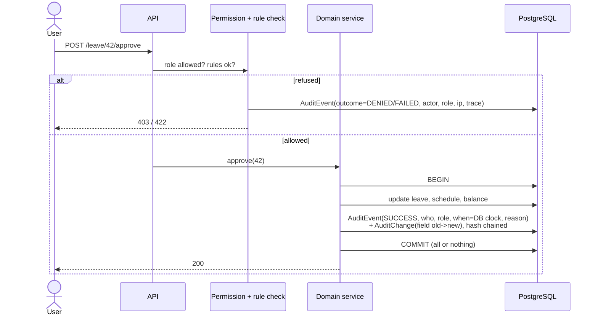

# Gijima WFM — Technical Specification

Status: **Draft v0.2.** Back end decided (Django) and front end decided (Vue 3), 12 Oct 2026. Hosting target undecided: built to be portable (§9). Requirement IDs refer to `01-REQUIREMENTS.md`.

## 1. Architecture and stack

Constraint: **open-source only, no paid licences** (production or development).

| Layer | Choice | Licence | Why |
|---|---|---|---|
| Frontend | Vue 3 (Composition API, `<script setup>`), TypeScript, Vite, Vue Router, Pinia (client state only), TanStack Query for Vue (server state), Tailwind CSS, Apache ECharts via vue-echarts | MIT / Apache-2.0 | Decided by VMK. The reference app was React, so its screens are re-implemented, not reused; the UI spec is framework-neutral |
| Backend API | Python 3.12, Django 5.2 LTS, Django Ninja (typed endpoints + OpenAPI) | BSD-3 / MIT | CRUD-, RBAC- and audit-heavy domain; built-in ORM, migrations, auth, admin |
| Audit trail | Own `AuditEvent` + `AuditChange` tables written by the service layer (authoritative); django-simple-history only for per-row version snapshots/History tabs | BSD-3 | Accountability (§6.1). simple-history alone is not enough: it does not fire on bulk operations |
| Engine | Plain Python package `wfm_engine` (NumPy, pandas, openpyxl, Google OR-Tools CP-SAT) — no Django imports | BSD / BSD / MIT / Apache-2.0 | Framework-free; unit-tested in isolation |
| Database | PostgreSQL 16 | PostgreSQL Licence (BSD-like) | Interval tables, window functions for reporting |
| Jobs | Celery + **Valkey** as broker | BSD-3 / BSD-3 | Imports, forecast runs, auto-schedule, report packs. Valkey rather than Redis because Redis ≥ 7.4 is no longer BSD-licensed (RSAL/SSPL, AGPL from 8.0) |
| Auth | Django sessions (HttpOnly cookie + CSRF) for the SPA; local users for dev/demo; Azure AD via OIDC (mozilla-django-oidc, MPL-2.0) in production | — | NFR-04 |
| Tests | pytest, pytest-django, testcontainers-python, Vitest, Playwright | MIT / BSD / Apache-2.0 / MIT / Apache-2.0 | §7 |
| Container runtime (dev) | Docker Engine on Linux/CI; **Docker Desktop** (WSL2 backend) on Windows dev machines | Apache-2.0 (engine) / Docker Desktop: free below 250 staff and US$10m revenue | VMK is under both limits (confirmed 12 Oct 2026). If VMK grows past either limit, switch to Rancher Desktop or Podman: nothing in the project depends on Docker Desktop specifically |
| Hosting | Docker Compose for dev; Azure South Africa North for production | — | NFR-03 data residency (hosting itself is a cost, not a licence) |

```
web (SPA) ──HTTPS/JSON──> api (Django + Ninja) ──> PostgreSQL
                               │   └── wfm_engine (pure Python)
                               └─> worker (Celery: imports, forecast, optimiser, reports) ─> Valkey
```

Repository layout:
```
/web        SPA (Vue 3)
/api        Django project  (config/, apps: accounts, org, people, forecasting, scheduling, leave, overtime, reporting, imports)
/engine     wfm_engine package (Erlang C, forecast, optimiser, KPI calc) — pure Python
/docs       these specs
/Files      source material (not deployed)
docker-compose.yml
```

## 2. Domain model (core tables)

| Entity | Key fields |
|---|---|
| Site | id, name, timezone |
| Customer / Contract | id, name, tier, sl_target_pct, sl_threshold_s, abandon_target_pct, asa_target_s, aht_target_s |
| Queue | id, site_id, contract_id, name, channel (voice/email/ticket), direction (inbound/outbound), open_hours, occupancy_ceiling |
| Employee | id, emp_no, name, team_id, manager_id, contract_type (permanent/seasonal), weekly_hours, work_mode (office/remote/hybrid), start/end date, **field_source** (imported / default) |
| AgentLogin | login (e.g. Agent124), employee_id — many-to-one (DAT-05) |
| Skill | employee_id, queue_id, level (L1–L3), proficiency |
| ShiftTemplate | code, start, end, paid_minutes, kind (early/day/late/night/split) |
| RosterWeek | queue/site, week_start, status (draft/published), published_by/at |
| ShiftAssignment | employee_id, date, template_id or start/end, queue_id, roster_week_id |
| Activity | shift_assignment_id, type (break/lunch/training/meeting/coaching), start, end, on_phone=false |
| Availability | employee_id, kind (unavailable/preferred), weekday or date, window, reason |
| LeaveType / LeaveBalance / LeaveRequest | type, entitlement days; request: employee, dates, part-day, status, approver |
| SwapRequest | from_assignment, to_assignment, status |
| OvertimeRequest / Standby / Callout | employee, date, minutes, rate multiplier, cost, status |
| CallRecord | call_id (unique), queue_id, login, type, start, queue_time, agent_time, hangup, wait_s, talk_s, wrap_s, hold_s, status, hangup_by |
| IntervalActual | queue_id, interval_start, offered, answered, abandoned, answered_in_sl, sum_wait_s, sum_handle_s |
| ForecastVersion / ForecastInterval | version: queue, label, status (draft/published), method; interval: volume, aht_s |
| ForecastEvent | queue, date range, uplift %, reason |
| RequirementInterval | queue, interval_start, forecast_version_id, required_raw, required_with_shrinkage (cached) |
| ShrinkageAssumption | team/queue, planned_pct, unplanned_pct, effective_from |
| CapacityPlan / CapacityPeriod / HiringCohort | horizon, attrition %, ramp curve, cost per FTE |
| ImportBatch | file name, sha256, sheet counts, period, row counts, reconciliation JSON, status |
| User / Role | role ∈ planner/lead/agent/admin/executive (+ optional auditor) |
| AuditEvent | id, occurred_at (DB `clock_timestamp()`), actor_user_id, actor_role, actor_type (USER/SYSTEM/INTEGRATION), subject_employee_id (nullable), action (enum), entity_type, entity_id, outcome (SUCCESS/DENIED/FAILED), reason, request_id, trace_id, session_hash, ip, user_agent, batch_id (nullable), prev_hash, hash |
| AuditChange | audit_event_id, entity_type, entity_id, field, old_value, new_value (sensitive values stored but only visible to roles allowed to see the field) |

All interval timestamps stored in UTC, displayed in Africa/Johannesburg; interval length 30 min (configurable).

## 3. API (REST, `/api/v1`)

`auth/login`, `auth/me` · `sites`, `queues`, `contracts`, `shift-templates`, `skills`, `activities` (CRUD, admin) · `employees`, `employees/{id}/logins` · `imports` (POST file → batch; GET report) · `intervals/actuals?queue&from&to` · `forecasts` (list, run, publish), `forecasts/{id}/intervals`, `forecast-events` · `planner/week?queue&week` → {intervals[ {start, required, scheduled, variance} ], kpis} · `planner/day?queue&date` · `planner/auto-schedule` (job) · `recommendations?queue&date`, `recommendations/{id}/apply` · `roster?queue&week`, `roster/assign`, `roster/clear`, `roster/publish`, `roster/export.csv` · `availability` · `leave`, `leave/{id}/approve|reject|cancel`, `leave/balances` · `swaps` · `overtime`, `standby`, `callouts` · `capacity/plans` · `intraday?queue&date` · `analytics/kpis`, `analytics/trend`, `analytics/scenario` · `reports/peaks-troughs`, `reports/packs`, `reports/payroll.csv` · `dashboard?site&week` · `audit` · `notifications`.

Every response carrying a KPI includes `{value, basis: "measured"|"modelled", coverage: {intervals_used, intervals_total}}` (DAT-10).

## 4. Engine

### 4.1 KPI definitions (must reconcile to DECK slide 2)
Computed per queue over inbound calls (`Call Type = INBOUND`):
- Offered = count; Answered = `Call Status = Agent`; Abandoned = `Call Status = Abandoned`
- Abandon % = abandoned / offered
- SL@20s = answered with `Queue Wait Time ≤ 20s` / offered (confirm denominator against DECK: May 81.1%, July 89.8%)
- ASA = mean queue wait of answered calls; AHT = mean (agent duration + disposition/wrap) of answered calls

Acceptance test: May → offered 5,649 / answered 5,181 / abandoned 468 / 8.28% / SL 81.1% / ASA 18.5s / AHT 3:35; July → 4,837 / 4,632 / 205 / 4.24% / 89.8% / 11.7s / 3:22. (Note: raw `Call Status` counts differ slightly — 480 vs 468 abandoned in May — so the exact filters, e.g. short-abandon threshold or transfer handling, must be pinned down until these numbers match.)

### 4.2 Requirement (Erlang C) per interval
```
λ = forecast volume / interval_seconds;  A = λ · AHT          (traffic, Erlangs)
EC(N,A) = (A^N/N! · N/(N−A)) / (Σ_{k=0}^{N−1} A^k/k! + A^N/N! · N/(N−A))
SL(N) = 1 − EC(N,A) · exp(−(N−A) · T / AHT)                    (T = SL threshold, e.g. 20s)
N_raw = min N > A such that SL(N) ≥ target AND A/N ≤ occupancy ceiling
N_req = ceil(N_raw / (1 − shrinkage))
```
Computed iteratively in log space to avoid factorial overflow. Variance = scheduled_on_phone − N_req.

### 4.3 Forecast
Baseline (MVP): for each queue × weekday × interval, weighted average of the last *k* same-weekday intervals (recent weeks weighted higher), scaled by a monthly trend factor and event uplifts. AHT likewise. Accuracy = 1 − MAPE vs actuals once they arrive. Phase 2: gradient-boosted model (LightGBM) with calendar features, selectable per queue.

### 4.4 Auto-scheduler
OR-Tools CP-SAT. Variables: employee × day × shift-template (+ queue). Hard constraints: skill, availability-unavailable, approved leave, one shift per day, ≥ 11h rest, max weekly hours / consecutive days (BCEA), contract hours. Objective: minimise Σ under-staffing (weighted ×3) + Σ over-staffing + preference violations + fairness spread. Time limit 10–30 s per queue-week; run as a job.

### 4.5 Recommendations
Greedy search over candidate moves (shift start ±30/60 min, swap template, add shift to agent under hours, reassign queue for multi-skilled agent) checked against the same hard constraints; ranked by reduction in Σ|negative variance|; apply = write assignment + recalc.

### 4.6 Overtime pricing (BCEA)
Hourly rate = monthly salary / (weekly hours × 4.333). Overtime 1.5×; Sunday 2× (or 1.5× if ordinarily works Sundays); public holiday 2×. Configurable.

## 5. Import specification — ACD Call Detail Report

Workbook with 7 sheets. Primary: **Call Record Report** (31 columns): Call ID, Phone Number, Access Number, Caller Number, Call Type (INBOUND / OUTBOUND / AGENT·BLIND·ATTENDED TRANSFER / FAILOVER), Trunk, Queue, Agent (`Name (AgentNNN)` or blank), Campaign, Start/Queue/Agent/Hangup/Disposition Time, Call Duration, Agent Duration, Queue Wait Time, Agent Wait Time, Disposition Name, Call Status (Agent / Abandoned / Dial / Failover), Sticky Agent Call, Hangup Reason (+Code, By), Callback Type, Total Hold/Mute/Disposition Duration, Transcription Status, Dialout Number, Route Type.
Secondary sheets: Call Disposition Details (remarks hold ITSM incident numbers, e.g. `INC000064329272` — useful link to tickets), Call IVR Details, Agent Offered Call (offers per agent — ring-no-answer analysis), Transfer, Mute, Hold details.

Rules: dedupe on Call ID; reject a batch whose file hash or (min,max) date range + row count matches an existing batch (catches June=May); parse `HH:MM:SS` durations; map Agent string → login via regex `\((Agent\d+)\)` else the raw login; queues auto-created on first sight (flagged for admin to confirm); produce reconciliation report (§4.1).

Observed queues: TotalSA, Platinumhealth, Gijima, PPECB, NightShiftTotalSA, NightShiftGijima, GHSA-Service-Desk (outbound only). 28–30 distinct agents per month, ~37 people overall.

## 6. Security
Role-based route guards on API and UI; row-level filtering for agents (own data only) and leads (own team); audit trail per §6.1; secrets via environment; HTTPS only; passwords bcrypt; POPIA export/delete endpoints for an employee.

### 6.1 Audit design

**Write path.** All writes go through domain services (never views or the admin site directly). A service runs inside `transaction.atomic()`: apply the change, then call `audit.record(action, entity, changes, reason)`, which inserts the `AuditEvent` + `AuditChange` rows in the same transaction. The actor, role, session, IP and trace id come from a request context object, so a service cannot forget them. Background jobs run with `actor_type=SYSTEM` and record who triggered them (`actor_user_id` of the requester, `batch_id` of the job).

**Why not rely on a model-signal library.** `post_save` signals (which django-simple-history uses) do not fire for `bulk_create`, `QuerySet.update()` or `QuerySet.delete()`. The importer and auto-schedule use bulk operations for speed, so they call `audit.record_bulk(...)` explicitly (one summary event with counts and a batch id, plus `AuditChange` rows for the changed assignments, or a before/after snapshot reference for the roster week). A lint rule bans direct `bulk_*`/`.update()` on audited models outside the audit-aware helpers.

**Denied and failed attempts.** The permission layer and the rule checker call `audit.record(outcome=DENIED|FAILED, ...)` before returning 403/422, so attempts are visible too. Login events are recorded by auth signals.

**Sensitive reads.** Endpoints that return pay rates, availability reasons or another person's record use a decorator `@audited_read(category)` that writes a READ event (who, which person, which fields) — not for ordinary dashboard views.

**Immutability.** Migration creates the audit tables owned by a separate DB role. The application role gets `INSERT, SELECT` only; a trigger also raises on `UPDATE`/`DELETE`. Hash chain: `hash = SHA-256(prev_hash || canonical_json(event))`, chained per day to keep inserts concurrent-safe; a nightly Celery task verifies the chain and pages on a break, and exports the day to immutable object storage (Azure immutable blob / WORM).

**Time.** `occurred_at` defaults to the database `clock_timestamp()`; the API ignores any client-supplied time. Stored as `timestamptz` (UTC), rendered in Africa/Johannesburg.

**Reading it.** Admin (and optional Auditor) screen: filter by actor, action, entity, outcome, date range; each row expands to the field-level changes; CSV export (audited). A **History** tab on leave requests, roster weeks, overtime and employees shows the same events scoped to what the viewer can already see.



## 7. Testing strategy

Every phase ships with tests at all four levels; a phase is not done until its tests are green in CI.

| Level | Tooling | What it covers | Database |
|---|---|---|---|
| Backend unit | pytest | Pure engine code: Erlang C (vs published Erlang tables), shrinkage, forecast maths, BCEA rule checks, OT pricing, CDR row parsing, variance classification | none — pure functions |
| Backend integration | pytest-django + Django test client + **Testcontainers (`testcontainers[postgres]`)** | API endpoints end to end through the Django ORM and migrations against a real PostgreSQL 16; role/permission matrix (every endpoint × every role); importer against **anonymised** May/July fixtures (phone numbers and names replaced, timings kept) with reconciliation to §4.1 | One Postgres container per test session (DATABASES pointed at it in conftest); Django migrations run once; each test runs in a transaction rolled back at teardown |
| Audit | pytest + Testcontainers Postgres (real DB permissions), Playwright | (1) Table-driven over the same endpoint list as the role matrix: every write produces exactly one `AuditEvent` with correct actor, role, action, entity, changes and server time; (2) denied and failed attempts are audited; (3) bulk paths (CDR import, auto-schedule, publish) produce summary + per-row events; (4) the app DB role cannot `UPDATE`/`DELETE` audit rows (raises); (5) altering a row breaks the hash-chain verifier; (6) a client-supplied timestamp is ignored; (7) atomicity: if the action rolls back there is no SUCCESS event, and if the audit insert fails the action does not commit; (8) role matrix on the audit screen and History tabs; (9) Playwright: approve leave as lead, then admin finds the entry with who/what/when | Testcontainers stack |
| Telemetry privacy | Vitest + Playwright | Event tracker drops any key outside the schema; a full Playwright journey per role captures outgoing analytics/trace requests and asserts none contain user ids, names, emails, pay values or form text | Testcontainers stack |
| Frontend unit/component | Vitest + Vue Testing Library (`@testing-library/vue`) | Components (heatmap cell colouring, roster cell states, KPI tile status), stores, formatters, route guards per role | none — API mocked with MSW |
| End-to-end | Playwright (Chromium + Firefox + mobile viewport) | User journeys per phase against the full stack: login per role → navigate → act → assert recalculated numbers; also negative paths (agent cannot reach Planner/Configure, cannot see others' leave) | Stack started with Docker Compose (Postgres container + seeded fixtures); reset between specs via a test-only seed endpoint disabled in production |

Other rules:
- **Role-leak tests are first-class.** For every endpoint, an integration test asserts the response for each role (agent sees only own rows; lead only own team; executive read-only).
- Golden-file tests for imports: the May and July KPI figures in §4.1 are fixed assertions.
- Coverage gate: engine ≥ 90% lines; API ≥ 80%; frontend ≥ 70%.
- CI (GitHub Actions, `ubuntu-latest` has Docker for Testcontainers): lint + typecheck → unit → integration → build → Playwright; Playwright traces/videos uploaded on failure.
- Local prerequisite: a Docker engine (Docker Desktop with WSL2 on Windows) — Testcontainers and the e2e stack need it.

## 8. Delivery plan

| Phase | Content | Exit |
|---|---|---|
| 0. Foundation | Repo, Docker, DB schema, auth + roles, app shell (sidebar, top bar, site/queue/week pickers, dark mode), seed demo data, Compose dev stack with the Aspire dashboard as OTLP viewer (§9), **OpenTelemetry end to end (browser → API → worker → DB), allow-listed event tracker, collector PII-stripping** so every later screen is instrumented from the start | Login as 4 demo users |
| 1. Data & engine | CDR importer + reconciliation, interval actuals, baseline forecast, Erlang C requirement | May/July KPIs match DECK exactly |
| 2. Plan & roster | Shift templates, employees, roster grid, coverage, planner heatmap + day chart, publish, CSV | Variance updates live on assign |
| 3. People | Leave + approvals + balances, swaps, availability, agent self-service | Leave approval changes coverage |
| 4. Optimise | Auto-schedule (CP-SAT), recommendations, overtime + pricing, shrinkage | Auto-schedule closes ≥ X% of gap |
| 5. Insight | Dashboard, analytics, peaks & troughs report, scheduled packs, payroll CSV, capacity planning, intraday | UIF reporting requirements covered |
| 6. Integrations | Employee master, roster seed, ticket/email, ACD agent-state → adherence, Azure AD | Depends on Gijima data |
| 7. Extras | Scenario planning, calibration, service-desk model, cross-queue flexing, standby, ML forecast | — |

The Copilot (requirements §3.12) is **parked**: not in any phase and not in the test plan. If it is ever requested, it comes after the role-scoping layer and the endpoint × role test matrix exist, and reuses them rather than adding a new data path.

### 8.1 Parked design note: Copilot (role-safe by construction)
```
User question -> API (session user) -> Copilot service -> LLM (sees tool schemas only, no data)
                                          ^   | tool call(name, args)
                                          |   v
                                  Tool router -> existing scoped services -> rows for THIS user only
                                          |
                                  fenced tool output -> LLM -> draft answer -> output check -> user
```
- **Tools** are a closed list of read functions (`my_schedule`, `my_leave`, `team_leave` (leads), `coverage_gap(queue, date)`, `kpi_summary(scope)`, ...). Each tool is registered with the roles allowed to call it; the router checks the role *before* calling the service, and the service applies `for_user()` scoping *again*. The model cannot name a user id or table it was not given.
- **Arguments are validated** against the same schemas as the API (an agent passing another employee id is rejected, not trusted).
- **Context hygiene:** the system prompt contains the role and tool descriptions only. No data is pre-loaded. A new conversation starts empty; nothing is cached or shared across users or roles.
- **Output check:** extract entities and numbers from the draft; each must be present in this request's tool results, else the reply is replaced by a refusal. Refusals are templated, not model-written, so they do not leak by wording.
- **Prompt injection:** tool results are wrapped as quoted data; the system prompt states that instructions found inside them must be ignored; free-text fields are length-limited and stripped of control sequences.
- **Writes:** none. Suggestions render as a confirm card that calls the normal endpoint (full validation, audit, permissions).
- **No text-to-SQL:** the model never writes queries; that would bypass the scoping layer.
- **Model hosting:** abstracted behind a small interface so a self-hosted open-weight model (fits the open-source-only rule, data stays in SA) or a contracted hosted API can be used. Decision pending (requirements AI-10).
- **Tests (§7):** a table-driven suite runs every (role x question x planted-injection) case against a stubbed model that tries to misbehave (asks for forbidden tools, forged ids, echoes data) and asserts the router and post-filter stop it; plus a smaller live-model smoke suite in nightly CI.

## 9. Deployment and environments (portable by design)

Hosting for the demo and for the on-site install is **not decided**. We therefore build once as standard containers and keep every host-specific detail out of the code.

**Portability rules**
1. One container image per process type: `api` (gunicorn), `worker` (Celery), `beat`, `web` (static files behind nginx or Caddy). The same image is promoted dev → UAT → prod; nothing is rebuilt per environment.
2. All configuration from environment variables (12-factor); secrets via the platform (env, Docker/K8s secrets, Key Vault). No hard-coded hostnames, regions or cloud SDKs in business code.
3. Stateless app tier; state only in PostgreSQL, Valkey and the file store (a path or an S3-compatible bucket behind one interface).
4. `/healthz` and `/readyz` on every service; graceful shutdown; migrations run as a separate release step, not at app start.
5. Telemetry exported over standard OTLP to whatever endpoint the environment provides.

**Environments**

| Environment | How it runs | Purpose |
|---|---|---|
| dev (local) | **.NET Aspire** AppHost (`infra/aspire/`) starts Django, Celery worker + beat, Postgres, Valkey and the Vue dev server on Docker Desktop; the Aspire dashboard shows traces, logs and metrics (OTLP) | Day-to-day work (decided 12 Oct 2026). Needs the .NET 10 SDK on each developer machine |
| CI | Compose + Testcontainers on GitHub Actions runners (no Aspire; plain containers) | Tests (tech spec §7) |
| Local Kubernetes (later) | Helm chart on Docker Desktop's built-in Kubernetes, smoke-tested with `kind` in CI | Proves the Kubernetes path before Gijima chooses |
| Demo (later, location open) | Same Compose file on one VM, or the Helm chart on a cluster | Synthetic data only unless Gijima agrees otherwise in writing and it is hosted in South Africa; no open sign-up; nightly reset; "DEMO" banner |
| UAT / prod (on-site) | Whatever Gijima provides: Kubernetes (Helm), a VM with Compose, or Azure Container Apps | Per customer, single-tenant |

**Aspire (decided for development).** The AppHost is a small C# project in `infra/aspire/`; it only starts and wires the services locally, so the application stack (Django, Vue, Postgres, Celery, Valkey) is unchanged and no production code depends on it. Cost: every developer needs the .NET 10 SDK. CI and any hosted environment use the same container images without Aspire. Aspire's Kubernetes publishing was still preview at the time of writing; verify before relying on it. Exact Aspire package versions and how current Aspire hosts Python, Celery and Valkey resources are to be confirmed in Phase 0.

### 9.1 Phase 0 findings (verified 13 Oct 2026, Aspire 13.6.1, .NET 10.0.401)

- Aspire hosting packages used: `Aspire.Hosting.PostgreSQL`, `.Valkey`, `.Python`, `.JavaScript`, SDK `Aspire.AppHost.Sdk/13.6.1`. The AppHost builds with one non-blocking warning, ASPIRE010 (CLI bundle not enabled); acceptable.
- Python resources must call `.WithUv()`. Without it Aspire runs `.venv/Scripts/pip.exe install .`, which does not exist in a uv-created environment.
- Aspire's `UriExpression` for Valkey is `valkey://...`, a scheme Celery/kombu rejects. Settings normalise it to `redis://` (`config/settings/_env.py`). The URL is passed as `WFM_BROKER_URL`, not `CELERY_BROKER_URL`, because the `celery` CLI reads `CELERY_BROKER_URL` itself (its `--broker` option) and would bypass the normalisation.
- Windows has no Celery prefork pool: the dev worker runs with `-P solo`.
- `DATABASES` sets `connect_timeout=5` so an unreachable database fails fast instead of hanging.
- Per-resource console output is available from the Aspire dashboard; for scripted debugging, the DCP API in the temp-dir `kubeconfig` serves `/executables/<name>/log`.

### 9.2 Web toolchain findings (verified 13 Oct 2026)

- **TypeScript is pinned to 5.x.** pnpm resolved TypeScript 7 (the native compiler), which no longer exposes the JavaScript API that `openapi-typescript` and `vue-tsc` use (`ts.factory` is undefined). Revisit when those tools support 7.
- **MSW 3 renamed the option** `onUnhandledRequest` to `onUnhandledFrame`. The old name is a type error and was silently ignored at runtime until the type check caught it; tests now fail on any request without a handler.
- **`openapi-fetch` captures `globalThis.fetch` when the client is created**, so later patches (test mocks, OpenTelemetry fetch tracing) are bypassed. The client passes a lazy `fetch` wrapper so it always uses the current one.
- **pnpm 12** ignores the `pnpm` field in `package.json`; install-script decisions live in `pnpm-workspace.yaml` (`allowBuilds`). `vue-demi`'s postinstall is denied (Vue 3 does not need it) because an undecided script makes `pnpm install` fail, which also broke Aspire's install step.
- **Windows PowerShell** blocks npm's `pnpm.ps1` under the default execution policy. The `justfile` calls `pnpm.cmd` on Windows rather than loosening the policy.
- **Routing:** the layout's own address is `/`, so the dashboard is its empty-path child. Giving the child the absolute `/` too let the bare layout match first and render an empty page.
- **Playwright:** a helper that clicks "Sign in" and returns immediately lets the next navigation abort the in-flight login, so `signIn` waits for the session. Tests run with `reducedMotion: 'reduce'` (the app honours it) so slide animations cannot make screenshots or assertions flaky. Accessibility is checked with axe (WCAG 2.1 A/AA) on the login page and the dashboard in light and dark.
- **Aspire:** `seed_demo --reset-passwords` runs on every start so the persisted generated demo password (user secrets, `demo-password`) always matches the database volume.
