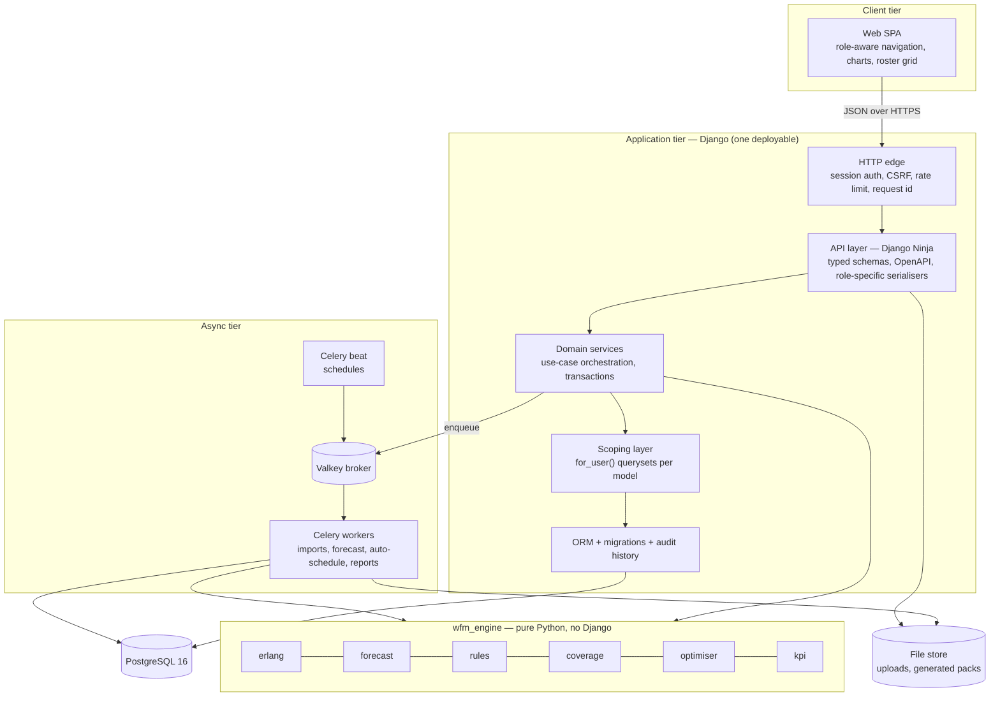
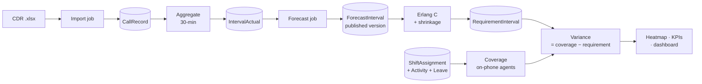
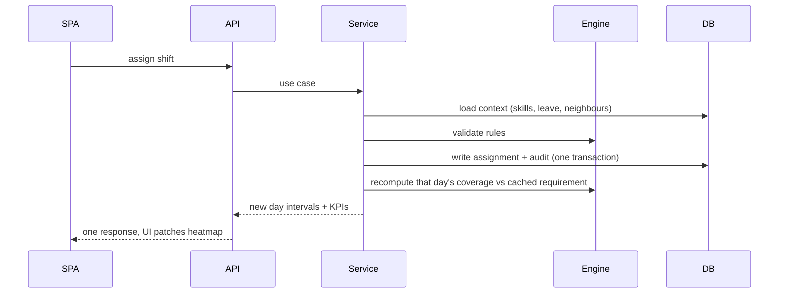
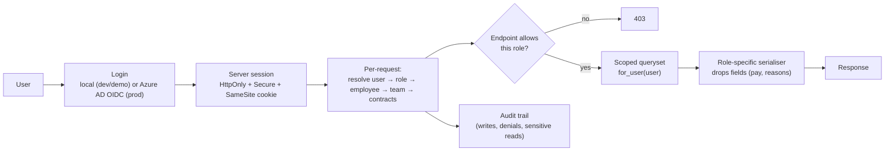
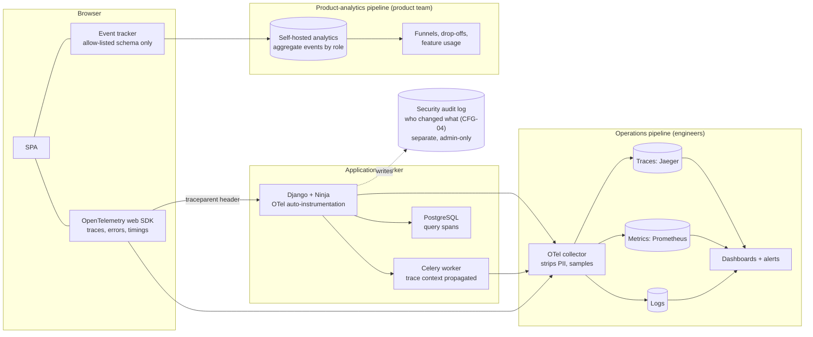

# Gijima WFM — System Design Overview

Status: Draft v0.1, 12 October 2026. Read with `02-TECH-SPEC.md` (stack, engine maths, tests) and `04-UML.md` (detailed models). This document is the one-stop picture: how the pieces fit, why, and what could go wrong.

## 1. Design goals (in priority order)

| # | Goal | What it drives |
|---|---|---|
| 1 | **Trustworthy numbers** — every KPI reconciles to source and says whether it is measured or modelled (DAT-02, DAT-10) | Engine kept pure and heavily tested; every API figure carries `basis` + `coverage` |
| 2 | **Role-safe data** — no role can see rows or fields outside its scope, even via the API (NFR-03) | One scoping layer, role-specific serialisers, role-leak tests on every endpoint |
| 3 | **Live feedback** — an edit recalculates coverage in under a second (NFR-02) | Recalculate per day/queue on write, return the new intervals in the response |
| 4 | **Open-source only, low run cost** | Django, PostgreSQL, Celery, Valkey; no paid licences |
| 5 | **Scale to 350 agents, 10+ queues, 24 months** (NFR-01) | Modest — a single database and a single app tier are enough (see §6) |
| 6 | **Honest about missing data** | Imports are additive and idempotent; screens show empty states rather than invented values |

## 2. Architecture at a glance

A modular monolith: one Django deployable made of focused apps, a framework-free calculation package, and a background worker. Deliberately not microservices — the team is small, the data is relational and tightly coupled (a leave approval touches roster, coverage and balances in one transaction), and the load is low.

### Layering rules
1. **API layer** only validates input, calls one service, and serialises output. No business logic.
2. **Domain services** own transactions and orchestrate: load data → call engine → persist → audit → notify.
3. **Engine** takes plain data structures in and returns plain data structures out. It never touches the database, HTTP, time (`now` is passed in) or settings. This is what makes the maths unit-testable in milliseconds and reusable by the web path and the worker alike.
4. **Scoping layer** is the only code allowed to build querysets for user-facing reads. Views never call `Model.objects.all()` directly (enforced by a lint rule and by the permission-matrix tests).
5. Apps depend downward only: `reporting` may read from everything; `org` depends on nothing.

## 3. Key data flows

### 3.1 Read path — from call to heatmap cell

- `IntervalActual` is **measured** truth; `ForecastInterval` and `RequirementInterval` are **modelled**. The two are never mixed in one field, which is how the "measured vs modelled" label stays honest.
- `RequirementInterval` is a cache keyed by (queue, interval, forecast version, shrinkage assumption). It is rebuilt when a forecast is published or shrinkage/SL targets change, not on every roster edit.
- Coverage is computed on demand from assignments (cheap: ≤ 350 agents × 48 intervals per day), so a roster edit never needs a batch job.

### 3.2 Write path — an edit that must feel instant

One round trip returns both the saved change and the recalculated day, so the UI never shows a stale heatmap and never has to guess.

### 3.3 Long-running work goes async
Imports, forecast runs, auto-schedule and report packs run in Celery. The API returns `202 {jobId}`; the SPA polls `GET /jobs/{id}` every 2 s (SSE/WebSocket only if live adherence in Phase 6 needs it). Every job is **idempotent** and writes its result in a single transaction, so a retry after a crash cannot half-apply.

## 4. Data architecture

| Concern | Decision | Reason |
|---|---|---|
| Store | Single PostgreSQL 16, single schema | Relational and transactional; volumes are small (see below) |
| Time | Store UTC; interval = `timestamptz` start of a 30-min bucket; display in Africa/Johannesburg | Avoid DST/zone bugs (SA has no DST, but the platform must not assume that); NFR-07 |
| Interval length | Constant `INTERVAL_MINUTES = 30` per site, not hard-coded in queries | 15-min later without a rewrite |
| History vs audit | Two things: `django-simple-history` row snapshots for History tabs; and a separate append-only `AuditEvent`/`AuditChange` trail (who, what, when, where, outcome) written in the same transaction as the change | Signal-based history misses bulk operations and denied attempts; accountability needs both |
| Imports | Raw `CallRecord` kept, `ImportBatch` tracks provenance; unique `call_id` | Idempotent re-import; June=May duplicate detection (DAT-03) |
| Derived data | Aggregates (`IntervalActual`, `RequirementInterval`) are rebuildable from raw + config | Never the only copy of anything |
| Soft deletes | Employees, queues, shift templates are deactivated, not deleted | History and audit stay valid |
| Defaults vs facts | `Employee.field_source` marks imported vs defaulted | DAT-10, DECK slide 7 |
| PII | Employee name, ID, pay rate, availability reasons (e.g. "caring responsibility") are personal/sensitive under POPIA | Field-level serialiser rules; availability *reason* visible only to the person, their lead, planner, admin |

**Volume estimate (so we don't over-engineer):** 10 queues × 48 intervals × 365 days ≈ 175k `IntervalActual` rows per year, the same again for forecast and requirement, ≈ 6k call records per month today (≈ 70k per year; even at 10× growth, under 1M). 350 agents × 365 days ≈ 128k assignments per year. All trivially within one PostgreSQL instance; indexes on (queue, interval_start) and (employee, date) are the only tuning needed.

## 5. Security design

| Threat | Control |
|---|---|
| Agent reads other agents' leave/pay/schedule | Scoping layer + role serialisers; permission-matrix integration test per endpoint × role |
| UI bypass / forged requests | All checks server-side; UI hiding is cosmetic only |
| CSRF / XSS | Cookie sessions with CSRF token; strict CSP; no `v-html`/`dangerouslySetInnerHTML` on user text |
| Credential theft | Pluggable SSO (OIDC for Entra, Okta, Keycloak, Google; LDAP/AD; SAML later), with local accounts restricted to break-glass roles in production, Argon2 locally and lockout on login: tech spec section 10 |
| Data exfiltration through reports/exports | Exports run through the same scoped querysets; export events audited |
| Malicious upload (xlsx) | Size/type limit, parse with openpyxl in read-only mode, no macros executed, processed in worker not web process |
| Tenant mix-up (if UIF becomes a second deployment) | Separate deployment per customer (single-tenant), not shared tables — open question #7 in requirements |
| Secrets in repo | Environment variables / Azure Key Vault; `.env` ignored |
| POPIA | SA region, encryption at rest and in transit, subject-access export and deletion endpoints, audit of reads of sensitive fields |
| Copilot leaks data across roles, or is tricked by planted text (built in v1) | Identity-bound, tool-only, read-only and gets no pre-loaded data; tools reuse the scoping layer through selectors only (a layer test enforces it); the rule-based default means no text reaches a model; output check, one templated refusal, injection-fenced tool output for any future model adapter; every question audited; the adversarial role-leak suite gates release (requirements §3.12, tech spec §8.1 and §12) |

### 5.1 Audit trail

Answers "what happened, at what time, by whom". Full requirements AUD-01..14; design in tech spec §6.1.

| Question | Where the answer comes from |
|---|---|
| **Who** | Actor user + role at the time + actor type (person / system job / integration) + affected employee when done on someone's behalf |
| **What** | Action code, entity, field-level old → new; bulk operations as a summary event plus detail |
| **When** | Database clock, UTC, never the browser; displayed in Africa/Johannesburg |
| **From where** | Hashed session, IP, user agent, request id, trace id (links to the technical trace) |
| **Outcome / why** | SUCCESS, DENIED or FAILED; mandatory reason on sensitive overrides |

Design rules:
1. **Written with the change, in one transaction** — no change without an audit event, and the action fails if the audit write fails.
2. **Append-only in the database** (insert/select only for the app account, triggers block update/delete) with a nightly hash-chain check and daily export to immutable storage.
3. **Covers more than writes:** logins and lockouts, denied access, exports, role changes, imports and sensitive reads (pay rates, availability reasons, others' records).
4. **Limited visibility:** Admin (and optionally a read-only Auditor); other roles only see the History tab of records they may already see.
5. **Separate from telemetry:** product analytics never reads it; operations traces share only the trace id for correlation.

## 6. Scalability and performance

- **Sizing:** one app container (2–4 gunicorn workers), one worker container, one PostgreSQL, one Valkey comfortably serve 350 agents plus planners. Horizontal scale is available (stateless app, sessions in DB or Valkey) but not needed at this size.
- **Hot paths:** coverage recompute for a queue-day (target < 200 ms server time), week heatmap (7 days × 48 intervals, one SQL aggregate + in-memory join, target < 500 ms), dashboard (a handful of grouped queries, cached for 30 s per site/week/role).
- **Erlang C** is cheap per interval; the expensive part is the optimiser, which is why it is async with a 10–30 s CP-SAT time limit.
- **Caching:** `RequirementInterval` table (persistent cache); short-TTL dashboard cache keyed by role scope so one role's cached payload is never served to another.
- **Pagination:** every list endpoint paginated; roster and heatmap are bounded by week.

## 7. Reliability and operations

| Area | Design |
|---|---|
| Availability | Target 99.5% (NFR-05); health endpoints `/healthz` (process) and `/readyz` (DB + broker) |
| Failure of worker | Jobs retry with backoff; the UI shows job status; web path keeps working |
| Failure of broker | Web app stays up; job submission returns a clear error; no silent loss |
| Backups | Daily PostgreSQL backup + point-in-time recovery; restore tested quarterly; DR replica in a second SA region if contracted |
| Observability | Structured JSON logs with request id and user id (no PII payloads), Prometheus metrics (request latency, job duration, queue depth, import rejects), alerting on readiness and job failure rate. End-to-end traces and aggregate usage analytics: see §7.1 |
| Configuration | 12-factor: all settings from environment; same container image for dev/test/prod |
| Migrations | Forward-only Django migrations, applied by a release step; backwards-compatible within one release so rollback of app code is safe |
| Releases | GitHub Actions: lint/typecheck → unit → integration (Testcontainers) → build images → Playwright on a Compose stack → deploy to UAT → manual promote to prod |

### 7.1 Observability and product analytics

Two separate pipelines with different audiences and different privacy rules. They are never joined.

**Operations pipeline (is it healthy, why is it slow?)**
- OpenTelemetry in the browser, Django, Celery and the DB driver. The browser starts the trace and sends a `traceparent` header, so one click can be followed: *click Approve → POST /leave/42/approve → 3 queries → recalc → 380 ms*.
- Front-end errors and slow screens (heatmap paint time, route change time, failed API calls) are reported with the same trace id.
- The collector removes or hashes anything that looks like personal data and samples (e.g. all errors, 10% of normal traces).
- Stack: OpenTelemetry (Apache-2.0), Jaeger (Apache-2.0), Prometheus (Apache-2.0). Grafana is AGPL-3.0: free for internal use, to be confirmed with legal.

**Product-analytics pipeline (where do people get stuck, what do they use?)**
- The SPA emits a small, fixed set of events, e.g. `screen_viewed{screen, role}`, `action_completed{action, role, ms}`, `validation_failed{action, rule_code, role}`, `form_abandoned{form, role}`, `empty_state_shown{screen}`.
- Payloads are checked against an allow-list schema **in the browser** before sending; unknown keys are dropped. Names, ids, free text, pay and form values cannot be sent because the schema has no field for them.
- Grouping key is a random per-session id that is not stored against a user. Analysis is **by role and screen**: e.g. "team leads abandon the leave-approval screen 18% of the time, mostly after the coverage-impact panel loads slowly".
- Self-hosted in the SA environment (candidate: PostHog open-source edition or Matomo; to be selected and licence-checked in Phase 0). No SaaS.

**What this will tell us (examples of improvement questions)**
| Question | Event evidence |
|---|---|
| Is the roster assignment flow confusing? | Rate of `validation_failed` by `rule_code` (e.g. 11-hour rest) per assignment attempt |
| Do planners use Auto-schedule or edit by hand? | `action_completed{auto_schedule}` vs `{assign_shift}` counts |
| Are screens too slow? | `action_completed.ms` percentiles + front-end traces |
| Which modules go unused? | `screen_viewed` by role over time |
| Where do leave requests stall? | funnel: apply → impact viewed → approve/reject |

**Privacy guardrails (summary; full list OBS-04 to OBS-10 in requirements)**
- Aggregate by role, never by person; no replay, no keystrokes, no form contents.
- Purpose is improving the system; not used to assess employees.
- Staff notice + information-officer sign-off before go-live; retention limits; data stays in South Africa.
- The security **audit log** (who changed what) is a different system with a different purpose and stricter access; it is not an analytics source.
- Unit test on the event tracker: any payload with a key outside the schema is dropped. Playwright test: perform a full journey and assert the captured analytics requests contain no ids, names or values.

## 8. Integration design

| Integration | MVP | Later | Failure mode |
|---|---|---|---|
| ACD call detail | Manual xlsx upload (CDR format in tech spec §5) | Scheduled SFTP/API pull (15 min) | Missed pull → import status shows staleness; dashboard banner "data last received at …" |
| ACD agent state | — | Event stream or ≤ 60 s poll (Phase 6) | Falls back to 15-min interval feed; adherence labelled by resolution |
| Employee master | CSV/xlsx import | Daily sync from HR/AD | Unknown employee → held in a review queue, not auto-created |
| Ticket/email | CSV import | ITSM API (ServiceNow / BMC Helix) | Empty screen with an explicit "no data supplied" state |
| SSO | Local users | Azure AD OIDC | Local admin break-glass account |
| Payroll/BI | CSV download | Scheduled export per pay cycle | — |
| Email | SMTP relay for notifications and packs | — | Queued and retried; in-app notification always created |

Each integration is an **adapter** in `imports/` that converts the external format into the same internal commands the manual import uses, so the core never depends on a vendor format.

## 9. Frontend design (framework-neutral)

- **State:** server state via a query cache (TanStack Query); minimal client state (filters: site, queue, week; theme).
- **Routing:** route guards by role; unauthorised routes are absent from the nav and return a 403 page if typed in.
- **Typed client** generated from the Ninja OpenAPI schema, so a backend change that breaks the UI fails the build.
- **Heatmap/roster performance:** virtualised rows for roster; heatmap is 7×48 = 336 cells, rendered directly.
- **Accessibility:** heatmap cells always show the signed number, not just colour (NFR-08); keyboard navigation in the roster grid.
- **Layout:** sidebar + top bar with global site/queue/week pickers (UI spec).

## 10. Testing approach in one line
Pure engine → unit; API + DB + role matrix → integration on a Testcontainers PostgreSQL; screens → component tests; journeys per role → Playwright. Details in tech spec §7.

## 11. Decision log

| # | Decision | Alternatives considered | Why |
|---|---|---|---|
| D1 | Modular monolith | Microservices | Small team, transactional coupling, low load |
| D2 | Django + Ninja | FastAPI, ASP.NET Core | Built-in auth/ORM/migrations/admin/audit for a CRUD + RBAC heavy domain; Python for the maths |
| D3 | Pure-Python `wfm_engine` | Logic inside Django models | Testability; portability to another framework |
| D4 | PostgreSQL only | Add a time-series/OLAP store | Volumes are small; one store simplifies consistency |
| D5 | Celery + Valkey | Redis, RQ, Django-Q | Mature, free, BSD; Redis licence changed |
| D6 | Server sessions + CSRF | JWT in browser storage | Same-origin SPA; easier revocation; less token-theft surface |
| D7 | Copilot v1 built (29 Oct 2026): pluggable answerer with a rule-based default, core questions per role, read-only; role-scoped by construction (fixed read tools over the scoped selectors, never direct DB access or text-to-SQL). A model-backed answerer stays parked until a provider is chosen (AI-10) | Build now | Owner decision; design rules in requirements §3.12 and tech spec §8.1, as built in §12 |
| D8 | Single-tenant deployments | Shared multi-tenant schema | Stronger isolation for a Gijima/UIF split; VMK proposal already says "single-tenant" |
| D9 | CP-SAT for rostering | Heuristics only, commercial solvers | Free, strong constraint modelling; time-boxed |
| D10 | Measured vs modelled in the API contract | Free-form numbers | Core to the product's credibility |
| D11 | Vue 3 front end (decided 12 Oct 2026) | React | VMK team choice; reference app's React code is not reused, so no rewrite cost is avoided by choosing React |
| D13 | Portable containers; hosting undecided; Aspire for local dev (decided), Compose in CI, Helm later | Commit to a hosting platform now | Hosting for demo/on-site is not known; same images run on VM, Kubernetes or Azure Container Apps |
| D12 | Two telemetry pipelines (operations traces; aggregate role-level usage events), never joined; audit log separate | One tool for everything; per-user analytics/session replay | POPIA purpose limitation; staff are the users, so per-person tracking would be workplace monitoring |

## 12. Risks and mitigations

| Risk | Impact | Mitigation |
|---|---|---|
| KPI numbers don't reconcile (480 vs 468 abandoned in May) | Loses trust on day one | Phase 1 exit gate is exact reconciliation; pin down filter rules (short-abandon threshold, transfers) with Gijima before building dashboards |
| Missing data feeds (tickets, HR, roster, agent state) | Large parts of the UI would be empty | Build with explicit empty states; CSV import paths first; demo seed data clearly labelled |
| Shrinkage defaulted at 30% drives every requirement | Over- or under-staffing recommendations | Show it as an assumption on every requirement view; calibration screen; replace with measured value once agent-state arrives |
| Auto-schedule time too long or infeasible | Planner distrust | Time limit, partial solution with an "unfilled slots" report, always hand-editable |
| Role-scoping bug leaks data | Serious POPIA incident | Single scoping layer, lint rule banning raw `objects`, exhaustive endpoint × role tests in CI |
| Scope growth (QA, field mobile, ITSM integrations) | Delay | Phase plan + change control; items parked in "could" |
| Developer machines can't run containers | No integration/e2e tests locally | Docker Desktop (VMK is within the free-use limits); CI is the safety net |

## 13. Where each document fits

| Document | Answers |
|---|---|
| 01-REQUIREMENTS | *What* must the system do, and why (traceable to the source files) |
| 02-TECH-SPEC | Stack, schema, engine formulas, import format, tests, phases |
| 03-UI-SPEC | What the screens look like (from the reference video) |
| 04-UML | Detailed models: use cases, classes, states, activities, sequences |
| 05-SYSTEM-DESIGN (this) | How it all fits together, and the reasoning |
| 06-CODE-ARCHITECTURE | Repository layout, patterns (modular monolith, command/query split, FSD), boundary rules |
| 07-CODING-STANDARDS | Style, tooling, API/DB conventions, git workflow, CI gates, Definition of Done |
