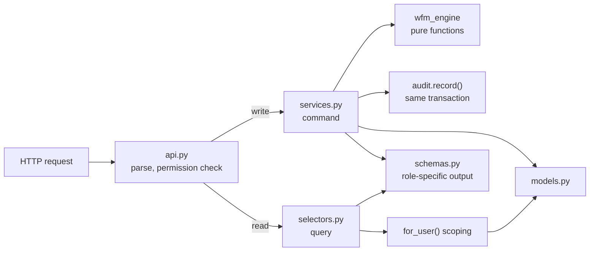

# Gijima WFM — Code Architecture and Repository Layout

Status: Draft v0.1, 12 October 2026. Read with `05-SYSTEM-DESIGN.md` (runtime view). This document is the **code** view: how the repository is organised, which patterns we use, and the rules that keep it that way.

## 1. The short answer

| Part | Pattern | In one line |
|---|---|---|
| Repository | **Monorepo** | Backend, engine, frontend, e2e tests and infra in one repo, versioned together |
| Backend | **Modular monolith, sliced by feature (bounded context)** | One Django project; each business area (scheduling, leave, …) is a self-contained module |
| Inside each backend module | **Light CQRS: commands and queries separated in code** | Writes go through *services* (transactional, validated, audited); reads go through *selectors* (role-scoped). One database, no separate read store |
| Calculation engine | **Functional core, imperative shell** | Pure functions (Erlang C, rules, coverage, optimiser) with no Django, DB or clock; the Django services are the shell around it |
| Integrations | **Ports and adapters (hexagonal) at the edges only** | ACD, HR, ITSM formats are adapters that translate into our own commands; the core never sees a vendor format |
| Frontend | **Feature-Sliced Design (lite)** | `app → pages → widgets → features → entities → shared`, each layer importing only from layers below |

### Why not the alternatives

| Option | Verdict | Reason |
|---|---|---|
| Classic horizontal layers (all models in one place, all services in another) | No | Every feature change touches every layer folder; no ownership; grows into a ball of mud |
| Full CQRS (separate read database, projections) and event sourcing | No | Our volumes are small (system design §4) and the product needs *immediate* consistency: assign a shift → heatmap updates in the same response. Projections would add lag and a second model to keep correct. The audit trail already gives full history |
| Microservices | No | Small team, transactional coupling (leave approval touches roster, coverage and balances at once), low load |
| Clean Architecture with repositories over the Django ORM | Partially | Wrapping the ORM in repository interfaces everywhere adds code with little gain in Django. We get the same isolation where it matters by keeping the maths in the pure engine and vendor formats in adapters |
| Light CQRS (command/query split inside modules) | **Yes** | Maps exactly onto our two hardest requirements: every command is **audited** (AUD-08) and every query is **role-scoped** (system design §5). Putting them in different places makes both rules easy to enforce and test |

## 2. Repository layout

```
WorkForceManagement/
├── api/                        Django project (backend)
│   ├── pyproject.toml
│   ├── manage.py
│   ├── config/                 settings/{base,dev,test,prod}.py, urls.py, celery.py, wsgi/asgi
│   └── wfm/                    one package per business module (see §3)
│       ├── core/               shared kernel (no business features)
│       ├── accounts/           users, roles, sessions, SSO, scoping rules
│       ├── org/                sites, customers, contracts, queues, teams
│       ├── people/             employees, logins, skills, availability
│       ├── imports/            CDR + employee master import, adapters
│       ├── forecasting/        actuals, forecast versions, events, requirement
│       ├── scheduling/         shift templates, roster, activities, planner, recommendations, auto-schedule
│       ├── leave/              leave types, balances, requests, swaps
│       ├── overtime/           overtime, standby, call-outs, pricing
│       ├── capacity/           capacity plans, hiring cohorts
│       ├── reporting/          dashboards, analytics, packs, exports
│       ├── notifications/      in-app + email notifications
│       └── audit/              AuditEvent, AuditChange, audit screen API
├── engine/                     wfm_engine: pure Python, no Django
│   ├── pyproject.toml
│   ├── src/wfm_engine/
│   │   ├── types.py            dataclasses shared across the engine
│   │   ├── erlang.py
│   │   ├── forecast/
│   │   ├── rules/              BCEA, rest, skills, availability checks
│   │   ├── coverage.py
│   │   ├── optimiser/          OR-Tools CP-SAT model
│   │   └── kpi.py
│   └── tests/
├── web/                        SPA (Vue 3), Feature-Sliced Design (see §5)
├── e2e/                        Playwright tests (cross-cutting, run against the full stack)
├── infra/
│   ├── docker/                 Dockerfiles
│   ├── compose/                docker-compose.dev.yml, docker-compose.e2e.yml
│   └── otel/                   OpenTelemetry collector config
├── docs/                       specifications (this folder)
│   └── adr/                    Architecture Decision Records, one file per decision
├── scripts/                    dev helpers (seed, anonymise fixtures, generate API client)
├── .github/workflows/          CI pipelines
├── .editorconfig  .gitattributes  .gitignore  .pre-commit-config.yaml
├── README.md                   how to run it
└── CONTRIBUTING.md             how to work in it (summarises 07-CODING-STANDARDS)
```

`Files/` (the source spreadsheets, PDF and video) stays **outside git**: it holds real caller phone numbers and staff names.

## 3. Backend module anatomy

Every module in `api/wfm/` has the same shape. Files start flat and become packages only when they grow (e.g. `services.py` → `services/`).

```
scheduling/
├── api.py            HTTP only: Ninja router, parse input, call ONE service or selector, return schema
├── schemas.py        request/response DTOs; role-specific output schemas (e.g. RosterOutForAgent)
├── models.py         Django models owned by this module
├── services.py       COMMANDS: write use cases, e.g. assign_shift(), publish_roster()
├── selectors.py      QUERIES: role-scoped reads, e.g. roster_for_week(user, queue, week)
├── permissions.py    which roles may call which use case
├── tasks.py          Celery entry points: thin, call a service
├── admin.py          Django admin registration (read-mostly; writes still via services)
├── migrations/
└── tests/
    ├── unit/         no DB: pure helpers, schema validation
    └── integration/  Testcontainers Postgres: api + services + selectors
```

### 3.1 The request flow



### 3.2 Command (service) template
A command is a plain function: keyword-only arguments, the acting user first, one transaction, validated by the engine, audited, returns domain objects.

```python
# scheduling/services.py
@transaction.atomic
def assign_shift(*, actor: User, employee_id: int, day: date, template_id: int, queue_id: int) -> ShiftAssignment:
    ensure_can(actor, "scheduling.assign_shift", queue_id=queue_id)
    context = load_rule_context(employee_id=employee_id, day=day)        # selectors of other modules
    violations = rules.validate_assignment(context, template, day)        # wfm_engine, pure
    if violations.hard:
        audit.record(actor=actor, action="shift.assign", outcome=FAILED, details=violations)
        raise RuleViolation(violations)
    assignment = ShiftAssignment.objects.create(...)
    audit.record(actor=actor, action="shift.assign", entity=assignment, changes=diff(None, assignment))
    return assignment
```

### 3.3 Query (selector) template
A query is a plain function that starts from a scoped queryset, never from `Model.objects` directly.

```python
# leave/selectors.py
def leave_requests_for(user: User, *, status: str | None = None) -> QuerySet[LeaveRequest]:
    qs = LeaveRequest.objects.for_user(user)        # agent: own; lead: own team; planner/admin: all
    return qs.filter(status=status) if status else qs
```

### 3.4 Module boundary rules (enforced by `import-linter` in CI)
1. `wfm_engine` imports nothing from `api/` (no Django). Contract: *independence*.
2. Inside a module: `api → services | selectors → models`. `api.py` may not import `models.py` directly. Contract: *layers*.
3. Across modules: a module may **read** another module's data only through that module's `selectors`, and **change** it only through that module's `services`. Foreign-key references to other modules' models are allowed; queries or writes against them are not.
4. `core` and `audit` are importable by everyone and import no feature module.
5. `reporting` may read from every module's selectors; no module imports `reporting`.
6. Raw `Model.objects` access, `bulk_create`, `QuerySet.update()` and `.delete()` on audited models are only allowed inside `services.py`, `selectors.py` and the audit-aware helpers (custom lint rule, AUD-08).

### 3.5 Shared kernel (`wfm/core`)
Request context (actor, role, request id, trace id), base scoped manager, error types and the API error format, pagination, time helpers (UTC ↔ Africa/Johannesburg, interval bucketing), money type (`Decimal`, rands), id helpers, feature flags. Nothing business-specific; if it mentions "leave" or "shift" it belongs in a module.

## 4. Engine (`engine/`)

- Pure functions over frozen dataclasses from `types.py`. No I/O, no `datetime.now()` (the caller passes `now`), no settings, no logging of personal data.
- Deterministic: same input, same output (the optimiser gets a fixed random seed).
- Published as a local package (`pip install -e engine`) so the API and worker import `wfm_engine` like any library, and it can be tested and benchmarked on its own.
- Each function documents units (seconds vs minutes, intervals vs hours) in its type names where possible: `AhtSeconds`, `IntervalCount`.

## 5. Frontend (`web/`) — Feature-Sliced Design (lite)

```
web/src/
├── app/          bootstrapping: router, providers, auth guard, theme, telemetry init
├── pages/        one folder per route: dashboard, planner, roster, forecast, leave, ...
├── widgets/      composite blocks used by pages: VarianceHeatmap, RosterGrid, KpiTileRow, NeedsAttention
├── features/     one user action each: assign-shift, approve-leave, publish-roster, run-forecast, import-cdr
├── entities/     domain types + data hooks: employee, queue, shift, leave-request, interval, forecast
└── shared/
    ├── api/      generated typed client from the OpenAPI schema (never hand-written)
    ├── ui/       design-system components (Vue SFCs): Button, Card, KpiTile, Pill, Table, Tabs, Select
    ├── lib/      dates, numbers, rand formatting, interval helpers
    ├── analytics/ allow-listed event tracker (OBS-05)
    └── config/
```

Rules:
1. A layer imports only from layers **below** it: `app → pages → widgets → features → entities → shared`. Enforced by the FSD linter (`steiger`) or `eslint-plugin-boundaries`.
2. Slices on the same layer do not import each other (`features/approve-leave` cannot import `features/assign-shift`); compose them in a widget or page.
3. Each slice exposes a public `index.ts`; imports from inside another slice's folder are blocked.
4. Server data lives in the query cache (TanStack Query); client state is only filters, theme and UI toggles.
5. Role checks in the UI are cosmetic (hide what the API would refuse anyway); the API is the authority.

Vue specifics: `<script setup lang="ts">` single-file components; composables (`useXxx`) for reusable logic, placed in the slice that owns them; Pinia only for client state (filters, theme); server data via TanStack Query for Vue.

## 6. Tests next to what they test

| What | Where |
|---|---|
| Engine unit tests | `engine/tests/` |
| Backend unit + integration | `api/wfm/<module>/tests/{unit,integration}/`; shared fixtures (Testcontainers Postgres, role users) in `api/conftest.py` |
| Cross-module and role-matrix tests | `api/tests/contracts/` (endpoint × role, audit coverage, telemetry privacy) |
| Frontend component tests | next to the component: `RosterGrid.test.ts` |
| End-to-end | `e2e/` by journey: `e2e/planner/publish-roster.spec.ts` |
| Fixtures | anonymised only: `api/tests/fixtures/cdr_may_anon.xlsx` produced by `scripts/anonymise_cdr.py` (phone numbers and names replaced, timings preserved so KPI golden tests still match) |

## 7. Architecture Decision Records

Each significant decision gets a short file in `docs/adr/NNNN-title.md` (Context, Decision, Consequences, Status). The decision log in system design §11 is seeded into ADRs 0001–0012 in Phase 0; new ones are added by PR. An ADR is never edited after acceptance; it is superseded by a new one.
